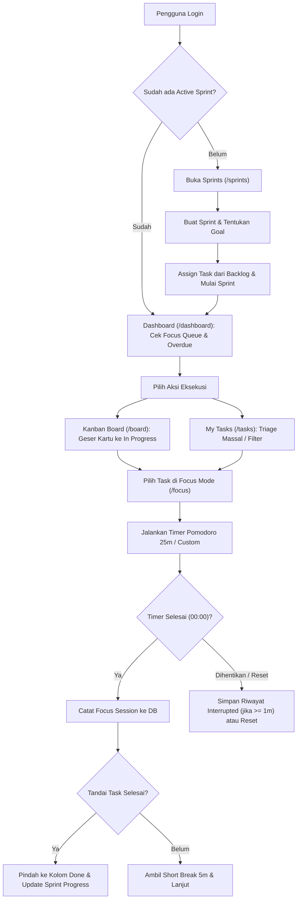
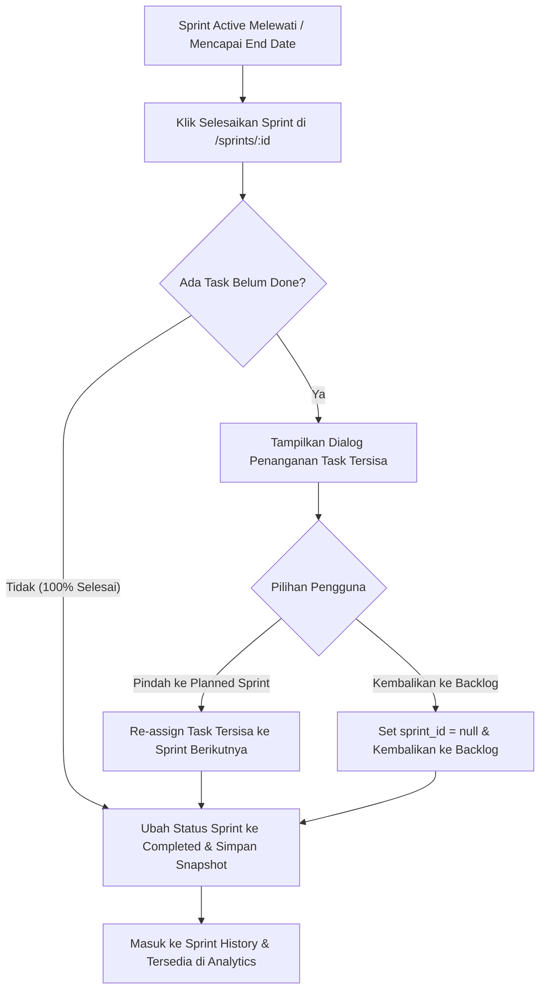
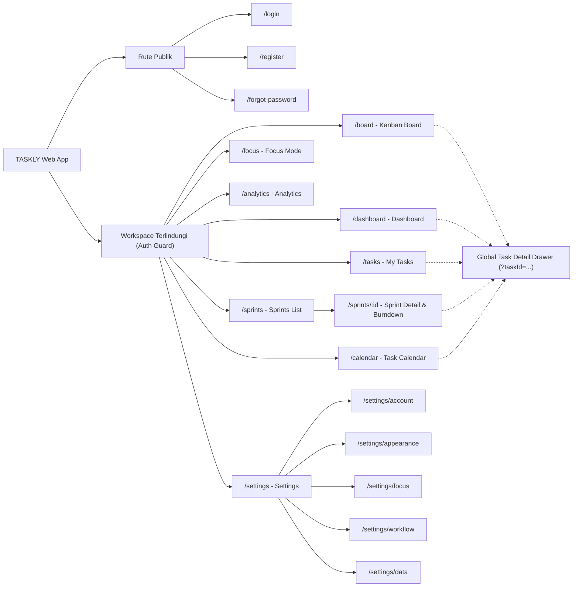
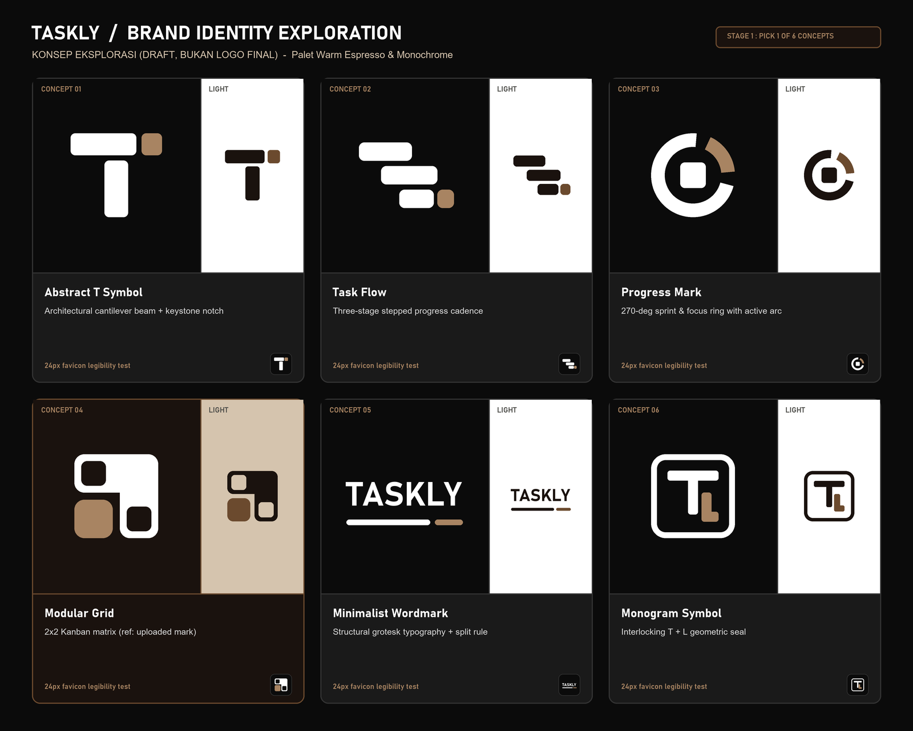
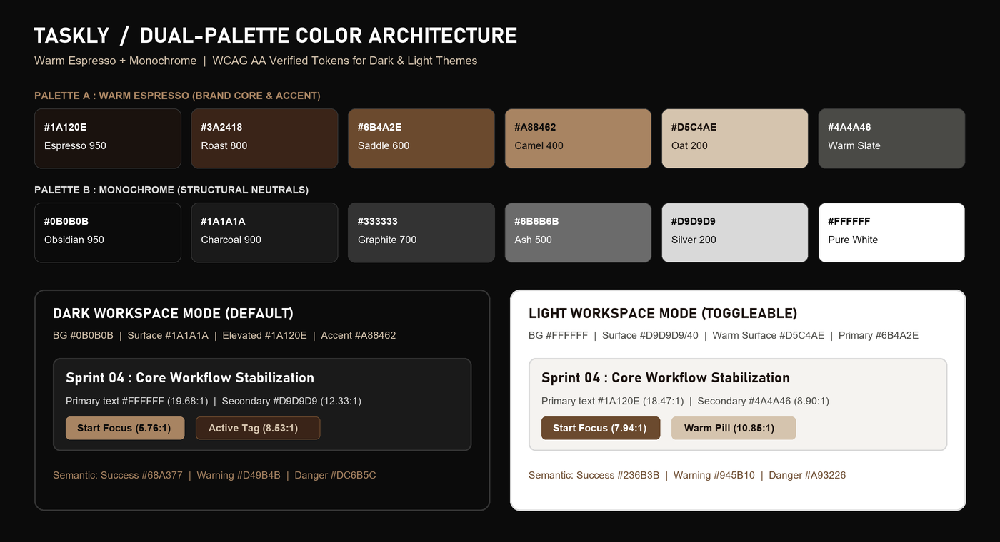
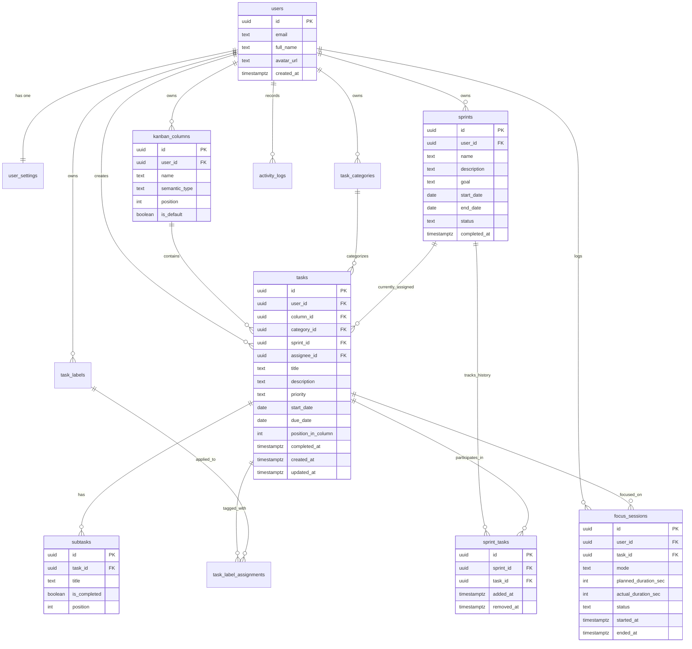

# Product Requirements Document (PRD): TASKLY

**Smart Productivity & Workflow Management Platform**

| Metadata Dokumen | Nilai |
| :--- | :--- |
| **Nama Produk** | TASKLY |
| **Versi Dokumen** | v1.0 (Pre-Design & Pre-Development Baseline) |
| **Status** | Menunggu Review PRD & Pemilihan Konsep Logo (1 dari 6) |
| **Tanggal** | 17 November 2026 |
| **Target Platform** | Responsive Web Application (Desktop, Tablet, Mobile) |
| **Stack Utama** | React JS, Vite, JavaScript (ESM), Tailwind CSS, Lucide Icons, Supabase (Auth & PostgreSQL) |
| **Mode Antislop** | Mode 1 (DURING): Diterapkan sejak perencanaan fitur, UI/UX, hingga token desain |

> [!IMPORTANT]
> **Status Tahap Saat Ini (Pre-Coding Gate)**
> Dokumen ini merupakan *single source of truth* sebelum penulisan kode aplikasi dimulai. Sistem warna telah dikunci menggunakan gabungan kedua palet referensi (**Warm Espresso** dan **Monochrome**) berbasis CSS variables yang mendukung Dark & Light mode. Untuk identitas logo, dokumen ini menyajikan **6 konsep eksplorasi (Draft, Belum Final)** agar Anda dapat memilih satu arah visual sebelum tahap desain UI detail dan pengembangan Phase 1 dimulai.

---

## 1. Executive Summary

**TASKLY** adalah aplikasi web produktivitas dan manajemen alur kerja (*workflow management workspace*) yang dirancang untuk menjembatani kesenjangan antara daftar tugas harian yang terlalu sederhana dengan perangkat lunak manajemen proyek korporat yang terlalu kompleks.

TASKLY menyatukan tiga pilar eksekusi kerja dalam satu ruang kerja terpadu:

1. **Kanban Board**: Pengelolaan status tugas secara visual berbasis kolom (`Backlog`, `To Do`, `In Progress`, `Review`, `Done`, dan kolom kustom) dengan interaksi *drag-and-drop* di desktop serta kontrol status khusus sentuhan di perangkat mobile.
2. **Sprint Management**: Pengorganisasian target kerja berbatas waktu (*time-boxed*) lengkap dengan penetapan *Sprint Goal*, pelacakan rasio penyelesaian, visualisasi *Sprint Burndown*, serta arsip riwayat sprint.
3. **Focus Mode**: Ruang eksekusi minim distraksi yang menggabungkan timer Pomodoro/kustom dengan pengikatan langsung ke satu tugas aktif (*Select Task to Focus On*) dan pencatatan telemetri sesi fokus harian.

Seluruh sistem didukung oleh **Dashboard** yang berorientasi pada keputusan eksekusi harian, halaman **My Tasks** untuk triase daftar tugas cepat, **Task Calendar** untuk pemetaan tenggat dan rentang sprint, **Analytics** untuk evaluasi produktivitas berbasis pertanyaan nyata, serta **Settings** untuk kustomisasi kolom, taksonomi label/kategori, tema warna, dan ekspor data.

---

## 2. Product Vision

Visi TASKLY adalah menghadirkan **workspace produktivitas harian yang tenang, terstruktur, dan berorientasi eksekusi**: tempat pengguna tidak sekadar mencatat pekerjaan, melainkan mengatur prioritas, menjaga ritme sprint, dan menyelesaikan tugas melalui sesi fokus yang terukur.

Prinsip utama pengalaman produk:
- **Workspace, bukan sekadar checklist**: Setiap tugas memiliki konteks status alur (Kanban), batas waktu periode (Sprint & Calendar), dan sesi eksekusi nyata (Focus Mode).
- **Kejelasan di atas kepadatan**: Layar hanya menampilkan data yang membantu pengguna memutuskan tindakan berikutnya, bukan dekorasi metrik.
- **Portabilitas & kontrol data**: Arsitektur dirancang modular dengan pemisahan layer data agar dapat berjalan cepat dan aman dengan persistensi permanen berbasis pengguna.

---

## 3. Product Goals & Objectives

### 3.1 Tujuan Produk (Product Goals)

| Kode | Tujuan Strategis | Cara TASKLY Mewujudkannya |
| :--- | :--- | :--- |
| **G-01** | Menyatukan pengelolaan tugas, sprint, dan sesi fokus dalam satu antarmuka konsisten | Mengintegrasikan entitas `Task` ke dalam 5 sudut pandang sinkron: List (`My Tasks`), Board (`Kanban`), Timebox (`Sprint`), Timeline (`Calendar`), dan Execution (`Focus Mode`). |
| **G-02** | Membantu pengguna memahami prioritas eksekusi harian tanpa kewalahan | Dashboard memprioritaskan antrean tugas mendesak/overdue dan kesehatan sprint aktif di atas metrik dekoratif. |
| **G-03** | Mengurangi pekerjaan yang tertunda atau terlewat tenggatnya | Peringatan tenggat terstruktur (`Overdue`, `Due Today`, `Upcoming 7 Days`), kalender lintas sprint, dan alur *carry-over* saat sprint berakhir. |
| **G-04** | Memberikan visibilitas progres berbasis periode nyata | Pelacakan persentase tugas selesai per sprint, grafik *Sprint Burndown* (Ideal vs Aktual), dan ringkasan konsistensi sesi fokus. |
| **G-05** | Menumbuhkan konsistensi eksekusi melalui sesi kerja mendalam | Focus Mode mengaitkan langsung timer 25/5/15 (atau kustom) ke tugas spesifik dan mencatat durasi riil yang terpakai. |

### 3.2 Engineering & Quality Objectives (Pre-Build Targets)

> [!NOTE]
> Angka di bawah ini adalah **target arsitektur (SLO)** yang ditetapkan sebagai kriteria desain sistem sebelum implementasi, bukan hasil pengukuran aplikasi yang sudah berjalan.

- **Kesiapan Responsif**: 0 horizontal overflow di viewport 375px (mobile), 768px (tablet), dan 1440px (desktop), dengan target sentuh minimal 44x44px pada perangkat mobile.
- **Aksesibilitas**: Kepatuhan WCAG 2.1 Level AA pada kontras teks (minimal 4.5:1 teks normal, 3:1 teks besar/ikon), operasi penuh via keyboard (`Tab`, `Enter`, `Space`, `Escape`), serta dukungan `prefers-reduced-motion`.
- **Keamanan Data**: Isolasi data ketat per pengguna melalui autentikasi terkelola dan PostgreSQL Row Level Security (RLS) pada setiap tabel milik pengguna.

---

## 4. Target Users & User Personas

> [!NOTE]
> Profil di bawah ini adalah **arketipe pengguna target** (`[USER ARCHETYPE - NON-FACTUAL TARGET PROFILE]`) yang disusun berdasarkan pola alur kerja produktivitas, bukan testimoni atau individu nyata.

### Archetype 1: Independent Product Builder / Indie Developer
- **Konteks Kerja**: Mengembangkan produk digital atau proyek freelance seorang diri dengan siklus rilis mingguan/dua mingguan.
- **Kebutuhan Utama**: Memecah fitur besar menjadi tugas kecil di Kanban, mengelompokkannya dalam Sprint 1-2 minggu, lalu masuk ke Focus Mode saat menulis kode agar tidak terpecah oleh backlog lain.
- **Hambatan Saat Ini**: Menggunakan aplikasi checklist terlalu dangkal (tidak ada konsep sprint/burndown), sedangkan tools enterprise terasa berat dan lambat diisi.

### Archetype 2: Sprint-Oriented Engineer / Technical Lead
- **Konteks Kerja**: Bekerja dengan target periodik yang terikat tenggat jelas dan memiliki banyak tugas paralel lintas kategori (Feature, Bugfix, Maintenance).
- **Kebutuhan Utama**: Menyaring board berdasarkan prioritas dan tenggat, memantau sisa pekerjaan sprint secara akurat, serta melihat distribusi tenggat terhadap rentang sprint di kalender.
- **Hambatan Saat Ini**: Sulit melihat keterkaitan antara daftar tugas harian, kapasitas waktu kalender, dan durasi kerja fokus aktual yang dihabiskan.

### Archetype 3: Academic / Knowledge Worker Berbasis Proyek
- **Konteks Kerja**: Mengelola riset, penulisan, atau proyek multi-tahap dengan banyak sub-tugas (*checklist*) dan tenggat bertumpuk.
- **Kebutuhan Utama**: Memecah deliverable menjadi subtask terukur, mengatur timer Pomodoro saat sesi membaca/menulis, dan mengevaluasi progres mingguan secara objektif.
- **Hambatan Saat Ini**: Timer fokus terpisah dari daftar tugas sehingga catatan waktu kerja tidak pernah tersambung dengan penyelesaian proyek.

---

## 5. User Problems & Solutions

| Masalah Pengguna | Akar Masalah | Solusi Spesifik di TASKLY |
| :--- | :--- | :--- |
| Tugas harian menumpuk tanpa kejelasan mana yang harus dikerjakan lebih dulu | Daftar tugas datar tidak membedakan urgensi, status sprint, dan keterlambatan | Dashboard menempatkan **Focus Queue Hari Ini** & daftar **Overdue / Upcoming Deadlines** sebagai titik fokus utama layar, dilengkapi Quick Add Task. |
| Kanban board penuh kartu lama yang tidak pernah selesai | Tidak ada batasan periode (*time-box*) dan tujuan eksplisit | **Sprint Management** memisahkan pekerjaan *Backlog* dari komitmen *Active Sprint*, dengan status `Planned`, `Active`, `Completed`, dan `Archived`. |
| Timer Pomodoro terputus dari konteks pekerjaan | Pengguna memakai aplikasi timer eksternal yang tidak terhubung ke tugas | **Focus Mode** mewajibkan/mendukung pemilihan tugas aktif (`Select Task to Focus On`) dan mencatat riwayat sesi serta total durasi fokus langsung ke tugas & analitik. |
| Tenggat tugas sering bertabrakan dengan akhir sprint | Tidak ada pandangan gabungan antara tanggal tugas dan periode sprint | **Task Calendar** memplot garis rentang sprint sekaligus marker deadline tugas pada tampilan Bulanan, Mingguan, dan Harian. |
| Board Kanban sulit dan menyebalkan dipakai di HP | Aplikasi web hanya mengecilkan kolom desktop menjadi gulir horizontal sempit | **Mobile Kanban Experience** memakai tab switcher kolom + kontrol aksi status cepat berbasis bottom-sheet yang ramah sentuhan (minimal 44px). |

---

## 6. Functional Requirements

Prioritas menggunakan skema MoSCoW versi praktis: **P0 (Wajib MVP)**, **P1 (Penting untuk kelengkapan v1.0)**, **P2 (Pengayaan terstruktur / Post-MVP awal)**.

| ID | Modul | Kebutuhan Fungsional | Prioritas |
| :--- | :--- | :--- | :--- |
| **FR-01** | Auth & Akun | Sistem menyediakan registrasi, login, logout, reset password, dan proteksi seluruh rute workspace untuk pengguna terautentikasi. | P0 |
| **FR-02** | Dashboard | Menampilkan ringkasan metrik nyata (Total, Completed, In Progress, Overdue Tasks), kartu Active Sprint, Overview produktivitas harian, Upcoming Deadlines, Recent Activities, Quick Add Task, dan visualisasi progres sprint. | P0 |
| **FR-03** | My Tasks | Menampilkan seluruh tugas dalam format daftar terstruktur dengan pencarian, penyaringan multi-kriteria, pengurutan, inline quick-edit status/prioritas, dan bulk assignment ke sprint. | P0 |
| **FR-04** | Kanban Board | Menampilkan kolom default (`Backlog`, `To Do`, `In Progress`, `Review`, `Done`) dan kolom kustom; mendukung Drag-and-Drop (desktop), keyboard movement, kontrol status mobile, Task Detail Modal/Drawer, serta filter status, prioritas, kategori, dan deadline. | P0 |
| **FR-05** | Task Entity & Subtasks | Setiap task menyimpan judul, deskripsi, status/kolom, prioritas, kategori, label, `start_date`, `due_date`, `sprint_id`, `assignee_id` (siap multi-user), checklist/subtasks, `created_at`, dan `updated_at`. | P0 |
| **FR-06** | Sprint Management | CRUD Sprint (nama, deskripsi, goal, durasi, start/end date, status `Planned`/`Active`/`Completed`/`Archived`), assign/unassign tasks, kalkulasi progres selesai vs sisa, Sprint Detail Page, Sprint Burndown chart, dan Sprint History. | P0 |
| **FR-07** | Focus Mode | Timer fokus dengan mode Pomodoro default (25/5/15 menit) dan mode Custom Timer yang dapat diubah pengguna; kontrol Start, Pause, Resume, Reset; pemilihan task aktif; pencatatan Focus Session History, statistik harian, jumlah sesi selesai, dan total durasi fokus. | P0 |
| **FR-08** | Task Calendar | Kalender tampilan Monthly, Weekly, dan Daily; menampilkan deadline task dan rentang timeline sprint; daftar Upcoming Tasks; navigasi antar tanggal (Next, Prev, Today); integrasi buka detail/edit task dari kalender. | P1 |
| **FR-09** | Analytics | Menampilkan Task Completion Rate, Weekly Productivity, Monthly Productivity, perbandingan Completed vs Pending, Sprint Completion Rate, Focus Time Statistics, dan Productivity Trends berbasis data aktual pengguna. | P1 |
| **FR-10** | Settings & Export | Pengelolaan profil pengguna, toggle tema (Dark / Light), konfigurasi default durasi Focus Mode, CRUD Task Categories & Labels, pengaturan Custom Kanban Columns, dan ekspor data JSON/CSV. | P1 |

---

## 7. Non-Functional Requirements

| Kategori | Kode | Spesifikasi Target |
| :--- | :--- | :--- |
| **Performance (Target SLO)** | **NFR-01** | Arsitektur client menggunakan code-splitting per rute (`React.lazy`), optimistic UI updates pada mutasi status Kanban agar interaksi drag-and-drop terasa instan secara lokal sebelum respons server selesai, serta virtualisasi/paginasi bila daftar task melebihi 200 item. |
| **Timer Accuracy** | **NFR-02** | Focus Timer tidak boleh mengandalkan akumulasi `setInterval(1000)` mentah yang meleset saat tab browser di-throttle; kalkulasi wajib berbasis selisih timestamp target (`endTimestamp - Date.now()`) atau Web Worker agar akurasi tetap terjaga. |
| **Accessibility** | **NFR-03** | Kepatuhan WCAG 2.1 AA: kontras teks normal >= 4.5:1, teks besar/komponen grafis >= 3:1, navigasi keyboard lengkap (`Tab`, `Enter`, `Space`, `Escape`), indikator fokus terlihat jelas pada setiap elemen interaktif, label `<label>` pada seluruh input, dan dukungan `prefers-reduced-motion`. |
| **Security & Isolation** | **NFR-04** | Enkripsi transport HTTPS, manajemen sesi berbasis token aman, validasi skema input di client (Zod) dan server/database (PostgreSQL constraints & RLS), serta pemisahan mutlak data antar pengguna (`auth.uid() = user_id`). |
| **Resilience & UI States** | **NFR-05** | Setiap layar berbasis data wajib menangani 3 kondisi secara eksplisit: **Loading state** (skeleton proporsional + label konteks), **Empty state** (penjelasan penyebab + satu CTA aksi pengisi data), dan **Error state** (pesan error yang jelas + tombol coba lagi). |
| **Maintainability** | **NFR-06** | Struktur kode modular berbasis fitur (`src/features/*`), pemisahan tegas design tokens dalam CSS variables dari komponen UI, dan zero duplikasi logika mutasi antar tampilan (Kanban, My Tasks, Dashboard, Calendar memakai layer repository yang sama). |

---

## 8. Detailed Feature Specifications

### 8.0 Modul Pendukung: Authentication & Protected Workspace Shell

- **Tujuan fitur**: Melindungi data pribadi pengguna sejak pintu masuk dan menjamin setiap sesi workspace terikat pada identitas pemilik data yang sah.
- **Cara kerja**: Pengguna yang belum memiliki sesi aktif diarahkan ke rute publik `/login` atau `/register`. Setelah autentikasi berhasil via Supabase Auth (Email/Password + opsi reset password), sesi disimpan oleh client SDK dan rute terlindungi membuka App Shell.
- **User interaction**: Form login/register dengan validasi inline real-time, toggle lihat/sembunyikan kata sandi, tombol kirim ulang tautan reset password, serta tombol Logout di panel akun Sidebar/Settings.
- **Data yang diperlukan**: `email`, `password` (minimum 8 karakter, tidak disimpan di client state setelah submit), `full_name` (saat registrasi), `session_token`, `user_id`.
- **Expected behavior**: Redirect otomatis ke `/dashboard` setelah login; jika pengguna membuka URL dalam seperti `/sprints/abc` sebelum login, sistem menyimpan tujuan (`redirectTo`) dan mengembalikan pengguna ke rute tersebut setelah login berhasil.
- **Edge cases**: Token kadaluarsa di tengah pemakaian (silent refresh gagal -> tampilkan dialog re-autentikasi tanpa menghapus draft input lokal bila memungkinkan); kredensial salah (tampilkan pesan aman tanpa membocorkan apakah email terdaftar); jaringan offline saat login.
- **Acceptance criteria**:
  - Rute `/dashboard`, `/tasks`, `/board`, `/sprints`, `/calendar`, `/focus`, `/analytics`, `/settings` tidak dapat dirender tanpa sesi valid.
  - Submit form kosong menampilkan pesan validasi spesifik per field dan memindahkan fokus ke field error pertama.

---

### 8.A Feature: Dashboard (`/dashboard`)

- **Tujuan fitur**: Menjadi pusat komando harian untuk menjawab satu pertanyaan utama: **"Apa yang perlu saya kerjakan sekarang, tenggat mana yang mendesak, dan apakah sprint aktif masih sesuai jalur?"** (Menghindari pola generik "4 kartu statistik seragam + grafik acak" sesuai prinsip antislop).
- **Cara kerja**: Mengambil snapshot real-time dari `tasks`, `sprints`, `focus_sessions`, dan `activity_logs` milik pengguna, lalu menyusun tata letak hierarkis berbasis prioritas tindakan:
  1. **Baris Konteks & Aksi Cepat (Top Focus Strip)**: Sapaan ringkas + tombol **Quick Add Task** (membuka input cepat inline atau modal ringkas).
  2. **Zona Utama (Asimetris 65% / 35% di Desktop)**:
     - Kiri (Primary Focal Zone): **Active Sprint Snapshot & Progress Visualization** (nama sprint, sprint goal, sisa hari, rasio selesai/total, bar progres, dan daftar **Tugas Prioritas / Upcoming Deadlines** yang bisa langsung diklik untuk dibuka detailnya atau dikirim ke Focus Mode).
     - Kanan (Secondary Context Zone): **Daily Productivity Overview** (jumlah tugas selesai hari ini + total menit fokus hari ini, hanya tampil angka riil atau status kosong jujur) dan **Recent Activities** (log aksi riil terbaru, mis. status berubah, sprint dimulai, sesi fokus selesai).
  3. **Strip Metrik Ringkas (Compact Summary Bar)**: Total Tasks, Completed Tasks, In Progress Tasks, dan Overdue Tasks ditampilkan sebagai indikator operasional ringkas yang masing-masing dapat diklik menuju filter terkait di `/tasks` (bukan kartu hiasan pasif tanpa aksi).
- **User interaction**:
  - Klik **Quick Add Task** (atau pintasan keyboard `N`) untuk membuat tugas baru tanpa meninggalkan Dashboard (judul, prioritas, tenggat opsional, sprint opsional).
  - Klik angka **Overdue Tasks** untuk langsung menuju `/tasks?filter=overdue`.
  - Klik tombol **Fokus** pada tugas di Upcoming Deadlines untuk langsung masuk ke `/focus?taskId=...`.
  - Klik tugas mana saja untuk membuka Task Detail Drawer.
- **Data yang diperlukan**: Agregasi `tasks` (total, count by semantic stage, `due_date < today` dan belum `done`), `sprints` (`status = 'active'`), `focus_sessions` (`started_at` hari ini), `activity_logs` (10 entri terbaru).
- **Expected behavior**:
  - **Loading state**: Menampilkan skeleton proporsional berlabel `"Memuat ringkasan workspace..."`.
  - **Empty state (Pengguna Baru)**: Jika 0 task dan 0 sprint, Dashboard tidak menampilkan angka `0` kosong di banyak kotak atau grafik hampa; sistem menampilkan kartu onboarding terarah dengan dua CTA nyata: **"Buat Tugas Pertama"** dan **"Rencanakan Sprint Pertama"**.
  - **Error state**: Menampilkan banner non-destruktif berisi penyebab kegagalan pemuatan dan tombol **"Muat Ulang Data"**.
- **Edge cases**:
  - Pengguna punya tugas, tetapi belum ada **Active Sprint**: Bagian Active Sprint berubah menjadi prompt kontekstual *"Belum ada sprint aktif. Aktifkan sprint terencana atau buat sprint baru"* dengan tombol menuju `/sprints`.
  - Terdapat lebih dari 10 tugas **Overdue**: Tampilkan 5 yang paling mendesak beserta tautan *"Lihat semua tugas terlambat di My Tasks"*.
  - Pengguna menghapus semua aktivitas: Recent Activities menampilkan empty state *"Belum ada aktivitas tercatat hari ini"*.
- **Acceptance criteria**:
  - Seluruh angka metrik (Total, Completed, In Progress, Overdue) cocok 100% dengan jumlah baris aktual di `tasks`.
  - Quick Add Task langsung memperbarui daftar Upcoming Deadlines dan Total Tasks tanpa reload halaman.
  - Setiap elemen ringkasan memiliki tujuan navigasi atau aksi nyata (tidak ada kartu metrik mati).

---

### 8.B Feature: My Tasks (`/tasks`)

- **Tujuan fitur**: Menyediakan tampilan daftar operasional berdensitas tinggi untuk triase cepat, pencarian teks, penyuntingan massal (*bulk triage*), dan pengelolaan tugas yang belum dijadwalkan di sprint (*backlog grooming*).
- **Cara kerja**: Merender seluruh tugas pengguna dalam baris tabel/daftar terstruktur dengan kontrol filter persisten (Status, Prioritas, Kategori, Sprint, Rentang Deadline), pengurutan (Due Date terdekat, Prioritas tertinggi, Terbaru diperbarui), serta mode seleksi banyak baris (*multi-select*).
- **User interaction**:
  - Pencarian instan berdasarkan judul, deskripsi, atau label.
  - Ubah status atau prioritas langsung dari baris (*inline dropdown*) tanpa harus membuka modal penuh.
  - Centang beberapa tugas untuk melakukan **Bulk Action** (Assign ke Sprint, Pindah Status, Ubah Kategori, atau Hapus dengan konfirmasi).
  - Klik judul baris untuk membuka **Task Detail Drawer**.
- **Data yang diperlukan**: Daftar `tasks` beserta relasi `task_categories`, `task_labels`, `sprints` (nama sprint), dan hitung jumlah `subtasks` (`completed / total`).
- **Expected behavior**:
  - **Empty state (Belum ada tugas)**: *"Belum ada tugas di workspace Anda. Tambahkan tugas pertama untuk mulai mengatur alur kerja."* + CTA **"Buat Tugas"**.
  - **Empty state (Hasil filter nihil)**: *"Tidak ada tugas yang cocok dengan filter saat ini."* + CTA **"Reset Filter"**.
  - **Loading state**: Baris skeleton tabel dengan tinggi seragam agar tidak terjadi layout shift.
  - **Error state**: Pesan gagal memuat daftar tugas + tombol **"Coba Lagi"**.
- **Edge cases**:
  - Konflik bulk assign ke sprint yang sudah `Completed` atau `Archived` -> dropdown sprint hanya menampilkan sprint berstatus `Planned` atau `Active`.
  - Pencarian dengan spasi berlebih atau karakter khusus -> di-trim dan disanitasi sebelum query.
- **Acceptance criteria**:
  - Perubahan status inline pada baris langsung tersinkronisasi ke Kanban Board dan Dashboard.
  - Bulk action memerlukan konfirmasi dialog khusus untuk aksi destruktif (**Hapus Terpilih**).

---

### 8.C Feature: Kanban Board (`/board`)

- **Tujuan fitur**: Mengelola alur kerja secara visual lintas tahapan status sehingga pengguna dapat memantau progres, hambatan (*bottleneck*), dan beban kerja pada setiap kolom dalam satu pandangan.
- **Cara kerja**:
  - Memuat kolom aktif milik pengguna (default 5 kolom bawaan saat workspace dibuat: `Backlog`, `To Do`, `In Progress`, `Review`, `Done`) yang diurutkan berdasarkan `position`.
  - Setiap kolom memetakan tugas berdasarkan `column_id` dan menyertakan atribut `semantic_category` (`backlog`, `todo`, `in_progress`, `review`, `done`) agar **Custom Kanban Columns** tetap kompatibel dengan kalkulasi progres Dashboard, Sprint Burndown, dan Analytics.
  - Di desktop, kartu mendukung **Drag and Drop** antar kolom maupun pengurutan ulang dalam satu kolom (`position` diperbarui secara persisten).
  - Di keyboard, kartu dapat dipindahkan memakai fokus + `Space` + tombol panah (`@dnd-kit` KeyboardSensor) atau lewat menu aksi kartu.
  - Di mobile (<768px), tampilan berganti menjadi **Mobile Column Tabs** (tab pilihan kolom di bagian atas dengan jumlah kartu per kolom) + tombol **Ubah Status / Pindah Kolom** langsung pada kartu yang membuka bottom sheet ramah sentuhan.
- **User interaction**:
  - Buat kolom kustom baru (`+ Tambah Kolom`), ubah nama kolom, atur urutan kolom, atau hapus kolom kustom (dengan opsi memindahkan tugas di dalamnya ke kolom lain sebelum dihapus).
  - Buat task baru langsung di dalam kolom tertentu (`+ Tambah Tugas di Kolom Ini`).
  - Filter papan berdasarkan: kata kunci pencarian, status, prioritas (`Low`, `Medium`, `High`, `Urgent`), kategori, atau filter deadline (`Hari Ini`, `Minggu Ini`, `Terlambat`, `Tanpa Tenggat`), serta filter konteks Sprint (`Semua Task` atau `Active Sprint`).
  - Klik kartu untuk membuka **Task Detail Drawer / Modal** berisi: Title, Description, Status/Column, Priority, Category, Labels, Start Date, Due Date, Sprint Assignment, Subtasks/Checklist (tambah, centang, hapus, urutkan), Assignee slot (disiapkan untuk fase multi-user), serta metadata `Created At` dan `Updated At`.
  - Hapus task dengan **Confirmation Dialog** yang jelas.
- **Data yang diperlukan**: `kanban_columns`, `tasks` (beserta `column_id`, `position_in_column`, `priority`, `category_id`, `labels`, `start_date`, `due_date`, `sprint_id`, `assignee_id`), `subtasks`, `task_categories`, `task_labels`, `sprints`.
- **Expected behavior**:
  - Drag-and-drop menerapkan **optimistic update** segera setelah kartu dilepas, lalu melakukan persistensi ke database; jika gagal, kartu dikembalikan ke posisi awal disertai toast error yang informatif.
  - Menambah/mencentang Subtask di Task Detail Drawer langsung memperbarui indikator checklist (mis. `2/5`) pada kartu Kanban.
  - **Empty state kolom**: Setiap kolom kosong tetap menjadi drop-zone valid dengan label halus *"Belum ada tugas di kolom ini"* agar target drop tetap jelas.
  - **Empty state board hasil filter**: Banner info di atas board bahwa filter aktif menyembunyikan kartu + tombol **"Reset Filter"**.
- **Edge cases**:
  - Pengguna mencoba menghapus kolom yang masih berisi tugas -> sistem wajib mencegah penghapusan langsung dan meminta pengguna memilih kolom tujuan migrasi tugas.
  - Pengguna mencoba menghapus seluruh kolom hingga 0 kolom -> sistem mewajibkan minimal 1 kolom berjenis `todo/active` dan 1 kolom `done` tetap ada agar alur kerja & burndown tidak rusak.
  - `Start Date` diisi lebih besar dari `Due Date` -> form validation menolak dengan pesan *"Tanggal mulai tidak boleh melewati tenggat waktu."*
  - Drag kartu dibatalkan dengan menekan `Escape` di tengah drag -> kartu kembali ke posisi semula tanpa memicu API call.
- **Acceptance criteria**:
  - Drag-and-drop antar kolom dan reorder dalam kolom bertahan setelah refresh halaman.
  - Semua field task (Title, Description, Status, Priority, Category, Start Date, Due Date, Sprint Assignment, Checklist, Created At, Updated At) dapat dibaca dan diperbarui via Task Detail Drawer.
  - Task Detail Drawer dapat ditutup dengan tombol `X`, klik backdrop, atau tombol `Escape`, serta mengembalikan fokus ke kartu pemicu.
  - Di viewport 375px, tidak ada horizontal overflow yang memecahkan halaman dan pengguna dapat memindahkan status task dalam maksimal 2 ketukan tanpa drag-and-drop.

---

### 8.D Feature: Sprint Management (`/sprints` & `/sprints/:id`)

- **Tujuan fitur**: Mengubah daftar tugas statis menjadi eksekusi berbasis target periode (*time-boxed*) dengan visibilitas penyelesaian dan tren sisa pekerjaan (*burndown*).
- **Cara kerja**:
  - Halaman `/sprints` menampilkan tab/pengelompokan sprint berdasarkan status: **Active**, **Planned**, **Completed**, dan **Archived**.
  - Aturan bisnis integritas alur: Pada satu waktu, direkomendasikan **maksimal 1 sprint berstatus `Active`** (jika pengguna ingin mengaktifkan sprint `Planned` sementara masih ada sprint `Active`, sistem memberi dialog konfirmasi untuk menyelesaikan/menghentikan sprint aktif terlebih dahulu agar fokus pengguna dan widget Dashboard tidak ambigu).
  - Halaman detail sprint (`/sprints/:id`) menampilkan: Sprint Name, Sprint Description, Sprint Goal, Duration (otomatis terhitung atau dipilih 1 minggu / 2 minggu / kustom), Start Date, End Date, Status badge, KPI ringkas (**Completed Tasks**, **Remaining Tasks**, **Sprint Progress %**), **Sprint Burndown Chart**, serta panel manajemen daftar tugas dalam sprint (termasuk opsi tambah task dari Backlog atau buat task baru langsung ke dalam sprint).
  - **Kalkulasi Sprint Burndown**:
    - Sumbu X: Hari ke-1 hingga hari terakhir sprint (`start_date` s.d. `end_date`).
    - Garis Ideal: Penurunan linear dari Total Task awal/saat ini menuju `0` pada `end_date`.
    - Garis Aktual: Jumlah tugas dalam sprint yang belum mencapai kolom berjenis `done` pada akhir setiap hari kalender (dihitung dari riwayat penyelesaian `completed_at` tugas di `sprint_tasks` / `tasks`).
    - Pertanyaan yang dijawab grafik (Aturan Antislop-UI): **"Sisa task sprint terhadap garis target harian (Ideal vs Aktual)"**.
- **User interaction**:
  - Buat sprint baru via Modal/Form (`Sprint Name`, `Description`, `Goal`, `Start Date`, `End Date`, atau preset durasi 7/14 hari).
  - Edit detail sprint (`Planned` atau `Active`).
  - Assign atau unassign tugas ke/dari sprint dari halaman detail sprint maupun dari Task Detail Drawer.
  - Aksi transisi siklus sprint: **Mulai Sprint** (`Planned -> Active`), **Selesaikan Sprint** (`Active -> Completed`), **Arsipkan** (`Completed -> Archived`), dan **Hapus Sprint** (konfirmasi dialog: tugas di dalam sprint TIDAK ikut terhapus, melainkan dikembalikan ke `Backlog` / `sprint_id = null`).
- **Data yang diperlukan**: `sprints` (`id`, `name`, `description`, `goal`, `start_date`, `end_date`, `status`, `completed_at`), `sprint_tasks` (`sprint_id`, `task_id`, `added_at`, `removed_at`), serta status & `completed_at` dari `tasks`.
- **Expected behavior**:
  - Saat **Selesaikan Sprint** ditekan sementara masih ada tugas yang belum `Done`, sistem menampilkan **Sprint Completion Dialog** berisi ringkasan tugas selesai vs tersisa, dan memberi pilihan eksplisit bagi tugas yang belum selesai: **Pindahkan ke Sprint Terencana Berikutnya** atau **Kembalikan ke Backlog**.
  - **Empty state (`/sprints`)**: *"Belum ada sprint yang dibuat. Kelompokkan tugas Anda ke dalam siklus sprint berbatas waktu untuk melacak target dan burndown."* + CTA **"Buat Sprint Pertama"**.
  - **Empty state (`/sprints/:id` tanpa task)**: *"Sprint ini belum memiliki tugas. Tambahkan tugas dari Backlog untuk mulai memantau progres dan burndown."* + CTA **"Tambah Tugas ke Sprint"**.
- **Edge cases**:
  - `End Date` kurang dari atau sama dengan `Start Date` -> ditolak validasi form.
  - Tugas baru ditambahkan di tengah sprint aktif -> Total scope burndown hari berjalan disesuaikan secara jujur dan tercatat di riwayat `sprint_tasks.added_at`.
  - Sprint melewati `End Date` tetapi belum ditutup pengguna -> tampilkan indikator status *"Melewati batas tanggal akhir"* dengan tombol cepat **"Selesaikan Sprint"**, tanpa memaksakan penutupan otomatis diam-diam agar pengguna tidak kehilangan kontrol atas tugas tersisa.
- **Acceptance criteria**:
  - CRUD Sprint (Create, Read, Update, Delete) bekerja penuh dengan validasi tanggal.
  - Penghapusan sprint tidak menghapus entitas tugas di database; tugas tetap tersedia di Backlog/My Tasks.
  - Halaman detail sprint (`/sprints/:id`) menampilkan seluruh tugas sprint, rasio progres yang akurat, dan grafik Sprint Burndown yang responsif di desktop maupun mobile.

---

### 8.E Feature: Focus Mode (`/focus`)

- **Tujuan fitur**: Menghilangkan distraksi visual dari manajemen daftar/papan saat pengguna memasuki fase eksekusi mendalam, sekaligus mengubah waktu kerja menjadi catatan produktivitas yang terikat pada tugas nyata.
- **Cara kerja**:
  - Menyajikan antarmuka minimalis berpusat pada satu elemen vokal utama: **Countdown Timer Ring / Digital Display** (`font-variant-numeric: tabular-nums`) dan **Selected Task Card** di bawahnya.
  - Mendukung 3 mode bawaan plus mode kustom:
    - **Focus** (default: `25 menit`, dapat diubah pengguna)
    - **Short Break** (default: `5 menit`, dapat diubah pengguna)
    - **Long Break** (default: `15 menit`, dapat diubah pengguna)
    - **Custom Timer** (pengguna memasukkan durasi bebas 1 s.d. 180 menit langsung untuk sesi ad-hoc tanpa merusak preset Pomodoro, atau menyimpan preset baru di Settings).
  - Sebelum/saat memulai sesi Focus, pengguna dapat memilih tugas aktif (`Select Task to Focus On`) dari tugas yang statusnya belum `Done`. Opsional: sesi fokus bebas tanpa task tetap diizinkan dengan label *"Fokus Umum"* agar tidak menghambat pengguna yang ingin langsung menyalakan timer.
  - Timer berjalan berbasis target waktu absolut (`targetEndTime`) sehingga tetap akurat walau tab browser berpindah ke latar belakang.
- **User interaction**:
  - Pilih mode (`Focus`, `Short Break`, `Long Break`, `Custom`).
  - Klik/pilih task dari selector (searchable dropdown task aktif).
  - Kontrol: **Start**, **Pause**, **Resume**, **Reset** (dengan konfirmasi singkat jika sesi sudah berjalan > 1 menit agar tidak ter-reset tidak sengaja), serta **Selesaikan Lebih Awal** (*Complete Early* yang mencatat durasi riil jika >= 1 menit).
  - Opsional toggle **Layar Penuh (Fullscreen API)** dan **Notifikasi Audio/Browser** saat timer mencapai `00:00`.
  - Saat sesi Focus selesai (`00:00`), tampil panel pasca-sesi: ringkasan durasi selesai, opsi **"Tandai Tugas Selesai"**, **"Lanjut Short Break (5m)"**, atau **"Mulai Sesi Focus Baru"**.
  - Bagian bawah / panel samping terlipat: **Daily Focus Statistics** (jumlah sesi fokus selesai hari ini, total menit/jam fokus hari ini) dan **Focus Session History** (daftar sesi hari ini & sebelumnya beserta nama tugas terkait).
- **Data yang diperlukan**: `focus_sessions` (`id`, `user_id`, `task_id` nullable, `mode`, `planned_duration_sec`, `actual_duration_sec`, `status` [`completed`, `interrupted`, `active`], `started_at`, `ended_at`), `user_settings` (preferensi durasi Pomodoro default).
- **Expected behavior**:
  - Refresh halaman atau berpindah rute sementara timer masih berjalan (jika user tetap di sesi lokal): status timer aktif dipulihkan dari `localStorage` sinkron dengan timestamp server/lokal agar timer tidak hilang saat tak sengaja refresh.
  - **Empty state Session History**: *"Belum ada riwayat sesi fokus. Pilih tugas dan mulai sesi 25 menit pertama Anda."*
  - **Loading / Error state**: Jika penyimpanan sesi ke backend gagal saat timer selesai, sistem menyimpannya ke antrean retry lokal (`pending_focus_sync`) dan memberi tombol **"Simpan Ulang Sesi"** sehingga menit fokus pengguna tidak hilang.
- **Edge cases**:
  - Pengguna mengubah durasi timer saat timer sedang berjalan (`running`) -> input pengubahan durasi dikunci sementara timer berjalan atau mewajibkan `Pause/Reset` terlebih dahulu agar data `planned_duration_sec` tetap valid.
  - Task yang sedang di-focus dihapus dari tab lain -> sesi fokus tetap berjalan dengan fallback label *"Tugas telah dihapus"* dan menyimpannya dengan `task_id = null`.
  - Browser memblokir notifikasi desktop atau autoplay suara -> fallback visual jelas di tab title (`(14:22) Focus - TASKLY`) + banner/modal penyelesaian di layar.
- **Acceptance criteria**:
  - Default Pomodoro persis `25 / 5 / 15` menit dan pengguna dapat mengedit durasinya.
  - Kontrol Start, Pause, Resume, Reset berfungsi akurat tanpa timer drift meskipun tab tidak aktif selama 10 menit.
  - Setiap sesi selesai tercatat di Focus Session History dan langsung memperbarui Daily Focus Statistics serta statistik di Analytics.
  - Di perangkat mobile, Focus Mode dapat mengisi seluruh viewport dengan tombol kontrol berukuran besar (>= 48px) di area jangkauan ibu jari.

---

### 8.F Feature: Task Calendar (`/calendar`)

- **Tujuan fitur**: Memetakan beban pekerjaan dan tenggat waktu pada dimensi kalender sehingga pengguna dapat melihat kepadatan jadwal serta keselarasan antara deadline tugas dan rentang sprint.
- **Cara kerja**:
  - Menyediakan 3 tampilan kalender: **Monthly View**, **Weekly View**, dan **Daily View**.
  - Merender dua lapisan informasi dalam satu grid:
    1. **Sprint Timeline Band**: Pita rentang tanggal horizontal di bagian atas hari-hari sprint (`start_date` s.d. `end_date`) dengan label nama sprint dan statusnya.
    2. **Task Deadlines**: Chip tugas pada tanggal `due_date` (dan indikator rentang bila `start_date` tersedia), diberi indikator prioritas & status selesai (`strikethrough`/opacity redup bila `Done`).
  - Panel samping atau bagian bawah (adaptif di mobile): **Upcoming Tasks** (daftar terurut tugas yang jatuh tempo dalam 7 hari ke depan).
- **User interaction**:
  - Navigasi antar tanggal: tombol **Prev**, **Next**, dan **Hari Ini** (*Today*).
  - Beralih tampilan antara `Month`, `Week`, dan `Day`.
  - Klik tanggal kosong pada kalender untuk **Quick Add Task** dengan `due_date` terisi otomatis sesuai tanggal tersebut.
  - Klik item tugas pada kalender untuk membuka **Task Detail Drawer** (edit tenggat, cek subtask, pindah status).
  - Klik pita sprint untuk membuka **Sprint Detail Page** (`/sprints/:id`).
- **Data yang diperlukan**: `tasks` (filter rentang tanggal viewport kalender saat ini), `sprints` (sprint yang rentangnya beririsan dengan rentang bulan/minggu tampilan).
- **Expected behavior**:
  - Jika satu hari pada Monthly View memiliki lebih dari 3 tenggat tugas, tampilkan 2-3 item teratas + indikator tombol **`+N lainnya`** yang jika diklik membuka popover daftar tugas tanggal tersebut atau beralih ke Daily View (mencegah sel kalender meluber berantakan).
  - **Empty state (Tidak ada tugas ber-tenggat di periode ini)**: Kalender tetap tampil sebagai grid interaktif dengan pesan halus pada panel Upcoming Tasks: *"Tidak ada tenggat tugas di periode ini. Klik tanggal mana saja di kalender untuk menjadwalkan tugas."*
  - **Loading & Error state**: Skeleton kalender ringan saat pergantian bulan jika perlu fetch rentang baru + error retry banner.
- **Edge cases**:
  - Tugas tanpa `due_date` -> tidak muncul di sel tanggal kalender, tetapi tidak hilang (tetap berada di My Tasks dan Kanban).
  - Perubahan `due_date` dari Task Detail Drawer atau drag-date (opsional P2) langsung memperbarui posisi kartu di kalender.
  - Perbedaan zona waktu lokal pengguna vs UTC database -> seluruh tanggal `due_date` disimpan/ditafsirkan secara konsisten (date-only `YYYY-MM-DD` untuk tanggal kalender murni agar tidak bergeser sehari akibat offset UTC+7!).
- **Acceptance criteria**:
  - Monthly, Weekly, dan Daily view menampilkan task deadlines dan sprint timeline secara akurat sesuai zona waktu lokal pengguna.
  - Navigasi tanggal dan tombol *Today* bekerja konsisten di semua view.
  - Mengubah `due_date` atau status task di kalender langsung tersinkronisasi ke Dashboard, My Tasks, dan Kanban.

---

### 8.G Feature: Analytics & Productivity Insights (`/analytics`)

- **Tujuan fitur**: Memberikan evaluasi berbasis bukti mengenai ritme penyelesaian tugas, konsistensi sprint, dan investasi waktu fokus dari waktu ke waktu.
- **Cara kerja**:
  - Setiap grafik wajib memiliki **judul berbasis pertanyaan** dan **filter rentang waktu nyata** (`7 Hari Terakhir`, `30 Hari Terakhir`, `90 Hari Terakhir`, atau rentang sprint).
  - Metrik & visualisasi utama:
    1. **Task Completion Rate**: Rasio tugas selesai dibanding total tugas dalam periode aktif.
    2. **Completed vs Pending Tasks**: Perbandingan jumlah tugas selesai vs belum selesai (termasuk pecahan status alur).
    3. **Weekly & Monthly Productivity Trends**: Grafik batang/garis menjawab *"Berapa banyak tugas yang selesai setiap minggu/bulan?"*
    4. **Sprint Completion Rate**: Tabel/grafik perbandingan antar sprint yang pernah diselesaikan (*"Berapa persen komitmen tugas sprint yang berhasil tuntas?"*).
    5. **Focus Time Statistics**: Grafik durasi fokus harian & rasio sesi selesai vs terinterupsi (*"Berapa jam waktu fokus yang benar-benar tercapai dalam periode ini?"*).
- **User interaction**:
  - Pilih rentang periode analisis (`7D`, `30D`, `90D`).
  - Hover atau fokus keyboard pada titik/batang grafik untuk membaca tooltip angka riil secara presisi.
  - Klik nama sprint pada grafik/daftar Sprint Completion Rate untuk meninjau `/sprints/:id`.
- **Data yang diperlukan**: Agregasi dari `tasks` (`created_at`, `completed_at`, `column_id`/semantic status), `sprints` (`status`, rasio task selesai), dan `focus_sessions` (`actual_duration_sec`, `status`, `started_at`).
- **Expected behavior**:
  - Seluruh kalkulasi angka bersumber 100% dari data pengguna yang login; tidak ada angka dummy atau baseline fiktif (R-17).
  - **Empty state**: Jika pengguna belum menyelesaikan satu pun tugas atau sesi fokus, grafik tidak digambar kosong melompong; sistem menampilkan penjelasan *"Analitik akan muncul setelah Anda menyelesaikan tugas atau sesi fokus pertama."* disertai tautan ke `/board` dan `/focus`.
  - **Loading & Error state**: Placeholder kartu grafik terukur (tanpa layout shift) dan pesan retry bila RPC analitik gagal.
- **Edge cases**:
  - Periode terpilih memiliki data tugas selesai `0` di beberapa hari -> sumbu tanggal tetap kontinyu menampilkan `0` secara jujur agar tren tidak terdistorsi.
  - Kontras warna segmen grafik -> setiap seri warna memenuhi rasio kontras minimal 3:1 terhadap background dan seri tetangganya (`#A88462`, `#D5C4AE`, `#6B4A2E`, `#FFFFFF` / `#1A120E`, plus pola/label tooltip).
- **Acceptance criteria**:
  - Tidak ada angka statistik fiktif atau delta tanpa data pembanding historis nyata.
  - Pergantian filter `7D` / `30D` / `90D` memperbarui seluruh metrik dan grafik secara konsisten.

---

### 8.H Feature: Settings & Data Management (`/settings`)

- **Tujuan fitur**: Menjadi pusat kendali preferensi workspace, konfigurasi sistem warna (tema), preset Focus Mode, taksonomi tugas, kolom Kanban kustom, dan portabilitas/keamanan data akun.
- **Cara kerja**: Terbagi menjadi bagian terstruktur berbasis tab/sub-navigasi:
  1. **Account & Profile**: Ubah nama tampilan, lihat email terdaftar, ganti kata sandi, dan aksi keluar/hapus akun.
  2. **Appearance**: Toggle **Dark Mode** dan **Light Mode** yang mengubah CSS variables global secara instan serta persisten ke `user_settings`.
  3. **Focus Preferences**: Atur default durasi Focus (menit), Short Break, Long Break, dan opsi auto-start break / notifikasi suara.
  4. **Workflow & Taxonomy**:
     - Kelola **Custom Kanban Columns** (tambah, ubah nama, atur semantic mapping, atur urutan, hapus dengan migrasi tugas).
     - Kelola **Task Categories** dan **Task Labels** (buat, edit warna dari token sistem yang aman, hapus).
  5. **Data & Export**: Unduh seluruh data workspace (`tasks`, `subtasks`, `sprints`, `focus_sessions`, `categories`, `labels`) dalam format **JSON** (lengkap) atau **CSV** (daftar tugas & sesi fokus).
- **User interaction**: Form dengan deteksi perubahan (*unsaved changes indicator*), tombol **"Simpan Perubahan"**, toast konfirmasi sukses, dan dialog konfirmasi ketat (ketik kata konfirmasi) untuk aksi hapus akun permanen.
- **Data yang diperlukan**: `users`, `user_settings`, `kanban_columns`, `task_categories`, `task_labels`.
- **Expected behavior**:
  - Toggle tema langsung mengubah `data-theme="dark"` / `data-theme="light"` pada elemen `<html>` tanpa reload, tanpa flash of unstyled content (FOUC) saat reload berikutnya.
  - Ekspor JSON/CSV men-generate file di sisi client atau via endpoint terautentikasi dengan nama file berstempel tanggal (`taskly-export-YYYY-MM-DD.json`).
- **Edge cases**:
  - Pengguna memasukkan durasi timer `0` atau negatif -> ditolak validasi (`min: 1`, `max: 180`).
  - Pengguna menghapus kategori/label yang sedang terpakai pada task -> tugas tidak terhapus; referensi `category_id` diset menjadi `null` atau label dilepas melalui relasi cascade yang aman, dengan peringatan jumlah task terdampak di dialog konfirmasi.
- **Acceptance criteria**:
  - Kedua mode (Dark & Light) berjalan utuh di seluruh 8 halaman tanpa komponen yang pecah atau teks ber-kontras rendah.
  - Ekspor JSON & CSV menghasilkan file valid berisi seluruh data milik pengguna aktif saja.

---

## 9. User Journey

### 9.1 Perjalanan Pengguna Pertama Kali (Onboarding s.d. Eksekusi Hari Pertama)
1. **Masuk & Autentikasi**: Pengguna membuka TASKLY, mendaftar dengan email dan kata sandi, lalu masuk ke `/dashboard`. Database secara otomatis menginisialisasi `user_settings` default dan 5 `kanban_columns` standar (`Backlog`, `To Do`, `In Progress`, `Review`, `Done`).
2. **Menangkap Pekerjaan**: Dari empty state Dashboard, pengguna mengeklik **"Buat Tugas Pertama"** atau menambah 3-4 tugas lewat Quick Add Task (menentukan prioritas dan tenggat).
3. **Menetapkan Sprint**: Pengguna membuka `/sprints`, membuat sprint pertama berdurasi 7 atau 14 hari dengan `Sprint Goal` yang jelas, memilih 3 tugas prioritas ke dalam sprint, dan menekan **"Mulai Sprint"**.
4. **Mengelola Alur Visual**: Pengguna membuka `/board`, menyaring ke Active Sprint, menggeser satu tugas ke `In Progress`, dan menambahkan 3 subtask di Task Detail Drawer.
5. **Menjalankan Sesi Fokus**: Pengguna mengeklik **"Mulai Fokus"** dari tugas tersebut, masuk ke `/focus` yang tenang, menjalankan timer 25 menit, menyelesaikan sesi, lalu mencentang 2 subtask yang telah tuntas.
6. **Evaluasi Harian**: Di penghujung hari, pengguna melihat Dashboard & `/analytics`: progres sprint bertambah secara nyata dan durasi fokus 25 menit tercatat dalam riwayat harian.

---

## 10. User Flow

### 10.1 Alur Utama Eksekusi Kerja (Task, Kanban, Sprint, Focus)



### 10.2 Alur Penutupan Sprint (Sprint Completion Flow)



---

## 11. Information Architecture

Untuk mencegah fitur saling tumpang tindih (Aturan Section 4), setiap halaman memiliki batas tanggung jawab yang tegas:

| Halaman | Peran Informasi | Objek Primer | Batasan Scope (Apa yang TIDAK ditaruh di sini) |
| :--- | :--- | :--- | :--- |
| **Dashboard** | Command center hari ini & kesehatan sprint saat ini | Snapshot gabungan (Queue, Active Sprint, Today Focus) | Bukan tempat edit massal tabel, bukan seluruh kolom Kanban, bukan arsip sprint lama. |
| **My Tasks** | Daftar operasional lengkap & triase massal | Koleksi datar `Tasks` (filter, sort, bulk edit) | Bukan papan kolom visual, bukan grafik burndown. |
| **Kanban Board** | Manajemen alur status visual per tahapan | `Columns` + `Task Cards` + `Detail Drawer` | Bukan kalender bulanan, bukan pengaturan durasi timer Pomodoro. |
| **Sprints** | Perencanaan periode, goal, & burndown per siklus | `Sprints` + `Sprint Tasks` + `Burndown` | Bukan daftar tugas pribadi non-sprint yang tidak relevan. |
| **Calendar** | Penjadwalan temporal & kepadatan tenggat | `Date Grid` + `Task Deadlines` + `Sprint Timeline` | Bukan kanban board atau analitik agregat jangka panjang. |
| **Focus Mode** | Eksekusi tunggal minim distraksi | `Timer` + `1 Selected Task` + `Session Log` | Tidak menampilkan sidebar navigasi penuh saat fullscreen, tidak menampilkan feed/board lain. |
| **Analytics** | Evaluasi tren & metrik historis berbasis rentang waktu | `Charts` + `Rates` + `Trends` | Bukan tempat membuat/mengedit tugas atau sprint. |
| **Settings** | Konfigurasi sistem, tampilan, taksonomi, & ekspor | `Settings` + `Columns` + `Categories` + `Labels` | Bukan data operasional harian. |

---

## 12. Sitemap



---

## 13. UI/UX Design Direction (Antislop Mode: DURING)

### 13.1 Design Read & Liveliness Dials

> **Design Read:** Reading this as: **Focused SaaS Productivity Workspace** for builders, engineers, and structured solo/team operators, in a **Warm Espresso & Monochrome Tactile-Minimalist** style, dial **ENERGY 2 / RHYTHM 2 / MOTION 1**.

- **ENERGY 2 (Balanced)**: Tampilan berwibawa dan hangat sekaligus. Struktur *Monochrome* (`#0B0B0B`, `#1A1A1A`, `#FFFFFF`) memberi presisi visual tinggi untuk membaca kartu dan data padat, sementara *Warm Espresso* (`#3A2418`, `#6B4A2E`, `#A88462`, `#D5C4AE`) memberi karakter merek yang membumi dan berbeda dari aplikasi SaaS ungu-biru generik.
- **RHYTHM 2 (Consistent with intentional breaks)**: Papan Kanban dan daftar My Tasks menjaga keteraturan grid yang disiplin agar mudah dipindai, namun Dashboard dan Focus Mode menggunakan komposisi asimetris dan focal point tunggal agar setiap layar memiliki hierarki visual yang jelas.
- **MOTION 1 (Calm / Functional only)**: Transisi mikro fungsional <= 180ms hanya pada hover, fokus keyboard, perpindahan drawer, dan penjatuhan kartu drag-and-drop. Tidak ada animasi melayang, pantulan berulang, atau pulse tak berujung (mematuhi R-19 dan `prefers-reduced-motion`).

### 13.2 Keputusan Visual & Alasan Tertulis (Aturan R-31)

| Aspek Desain | Keputusan Spesifik | Alasan Desain (1 Kalimat per Keputusan) |
| :--- | :--- | :--- |
| **Kombinasi Palet (R-01, R-29)** | Menggabungkan Monochrome sebagai dasar struktural netral dan Warm Espresso (maks. 2 warna inti `#3A2418`/`#6B4A2E` + 1 aksen utama `#A88462`) | Memisahkan struktur baca yang netral dari sinyal prioritas/brand hangat sehingga fokus mata langsung jatuh pada aksi paling penting tanpa kebisingan warna. |
| **Dual Theme Support (R-21, R-34)** | Menyediakan **Dark Mode** (obsidian `#0B0B0B` + espresso `#1A120E`) sebagai default opsional dan **Light Mode** (`#FFFFFF` + oat `#D5C4AE`) via toggle fungsional penuh | Pekerja fokus jangka panjang maupun sesi malam sering memilih permukaan gelap redup silau, sementara sesi siang di ruangan terang membutuhkan kertas putih ber-kontras tinggi. |
| **Tipografi (R-06)** | **IBM Plex Sans** untuk UI & heading; **IBM Plex Mono** khusus angka timer/durasi/shortcut dengan `font-variant-numeric: tabular-nums` | IBM Plex Sans memadukan presisi grid teknis dengan kehangatan humanis yang selaras dengan nuansa Warm Espresso, sementara angka tabular menjaga timer Focus Mode tidak bergeser saat detik berubah. |
| **Kebijakan Ikon (R-04)** | Menggunakan **Lucide Icons** (permintaan stack Section 1) dengan disiplin: `strokeWidth={1.75}`, ukuran konsisten `16px`/`18px`, hanya ikon bermakna semantik nyata, tanpa ikon dekoratif (*sparkle/magic/robot*) | Menyeragamkan ketebalan garis ikon dengan bobot huruf IBM Plex Sans sekaligus mencegah antarmuka terlihat seperti template AI yang menempel ikon di setiap label. |
| **Radius Hierarchy (R-11)** | 3 skala radius tetap: `6px` (tombol kompak, badge status, input kecil), `10px` (kartu Kanban, panel form), `14px` (modal, drawer, container utama) | Perbedaan radius menandakan hierarki lapisan UI secara intuitif dibandingkan memakai bentuk pil seragam di setiap komponen. |
| **Elevasi & Shadow (R-12, R-10, R-13)** | Permukaan datar berbasis border (`1px solid var(--border)`), shadow tipis hanya pada layer melayang (kartu sedang di-drag, popover, modal), 0 glassmorphism blur, 0 glow dekoratif | Menghindari efek melayang berlebihan pada seluruh kartu agar perbedaan antara permukaan kerja statis dan elemen aktif langsung terbaca. |
| **Anti-Slop Dashboard Layout (C-3)** | Dashboard dibangun asimetris berpusat pada *Active Sprint + Focus Queue Hari Ini*, bukan grid 4 kartu angka identik + chart generik | Menjadikan Dashboard sebagai alat pengambil keputusan eksekusi pagi hari, bukan sekadar pajangan statistik yang tidak mengarah ke tindakan. |
| **Identitas Motif (Part 3)** | Garis aksen struktural terbagi (*split rule* / marker progres proporsional beraksen `#A88462`) dan tipografi indeks bernomor pada sprint/sesi | Menciptakan benang merah visual yang konsisten antara branding, progress bar sprint, dan cincin timer Focus Mode. |
| **Copywriting & CTA (R-02, R-15, R-16)** | CTA spesifik tindakan (*"Buat Tugas Pertama"*, *"Mulai Sesi 25m"*, *"Selesaikan Sprint"*), bebas buzzword AI, dan bebas tanda em dash | Menjaga suara produk tetap ringkas, jujur, dan berorientasi kerja nyata bagi pengguna profesional. |

---

## 14. Brand Identity Exploration: 6 Logo Concepts

> [!WARNING]
> **Status Eksplorasi Identitas Visual (Aturan R-23 & Section 6)**
> Keenam konsep di bawah ini adalah **alternatif eksplorasi tahap pertama (Draft, Belum Final)**. Belum ada satu pun logo yang ditetapkan sebagai identitas final sebelum Anda memilih salah satu arah konsep.

### 14.1 Papan Perbandingan Visual (6 Konsep)



**Referensi Visual yang Anda Unggah:**


Ikon kotak modular 2x2 yang Anda lampirkan diintegrasikan secara langsung sebagai basis inspirasi **Concept 04 (Modular Grid)** agar Anda dapat membandingkannya secara setara dengan 5 arah visual lainnya.

### 14.2 Analisis Filosofi, Bentuk, dan Karakter Setiap Konsep

#### Concept 01: Abstract T Symbol ("Architectural Beam")
- **Filosofi**: Huruf `T` ditafsirkan sebagai balok penopang arsitektural (*cantilever beam*) dan satu blok pengunci (*keystone*) berwarna `#A88462` di kanan atas yang melambangkan satu tugas prioritas yang mengunci struktur kerja.
- **Bentuk Geometris**: Batang horizontal kokoh berujung melengkung halus (`radius 6%`), berjarak rapat terhadap batang vertikal utama, serta satu bujur sangkar kecil beraksen hangat yang terpisah oleh celah presisi.
- **Karakter Produk**: Tegas, struktural, stabil. Cocok jika TASKLY ingin menonjolkan citra *discipline & priority clarity*.
- **Skalabilitas**: Sangat kuat pada ukuran 16px-24px favicon dan ikon aplikasi mobile karena siluet luarnya sederhana dan tidak punya garis tipis yang hilang saat diperkecil.

#### Concept 02: Task Flow ("Stepped Horizon")
- **Filosofi**: Merepresentasikan pergerakan nyata tugas melewati tiga tahap alur kerja (Backlog, Active, Done) secara bertingkat, diakhiri node aksen `#A88462` sebagai penanda penyelesaian (*milestone*).
- **Bentuk Geometris**: Tiga batang horizontal berurutan yang bergeser secara diagonal ke kanan bawah dengan ketebalan identik, tanpa ikon centang generik.
- **Karakter Produk**: Dinamis, teratur, berorientasi alur (*momentum-driven*). Cocok untuk menonjolkan integrasi Kanban dan Sprint.
- **Skalabilitas**: Tetap terbaca jelas di 24px favicon; di bawah 16px, celah antar batang harus dijaga minimal 2px agar tidak menyatu.

#### Concept 03: Progress Mark ("Sprint Arc")
- **Filosofi**: Menggabungkan simbol **Sprint Burndown** dan **Focus Timer** ke dalam satu tanda lingkaran terbuka 270 derajat dengan busur progres aktif (`#A88462`) dan jangkar inti di tengah (tugas yang sedang dikerjakan).
- **Bentuk Geometris**: Cincin geometris terputus berketebalan tinggi dengan segmen busur terpisah di kuadran kanan atas serta kotak membulat solid di pusatnya.
- **Karakter Produk**: Terukur, fokus, tenang. Sangat kuat mewakili pilar Focus Mode dan Sprint tracking sekaligus.
- **Skalabilitas**: Terbaca sangat baik di ukuran 16px-512px dan terasa alami bila dipakai sebagai indikator loading atau ikon tab browser saat timer Focus berjalan.

#### Concept 04: Modular Grid ("Kanban Matrix", Terinspirasi Referensi Anda)
- **Filosofi**: Mengadaptasi langsung referensi visual Anda berupa matriks 2x2 tempat tiga ruang membentuk kerangka papan yang saling terhubung, sementara satu blok di kiri bawah berdiri terpisah sebagai kartu tugas yang siap dipindahkan atau sedang dikerjakan.
- **Bentuk Geometris**: Struktur L-frame menyatu (kiri atas berlubang, kanan atas solid, kanan bawah berlubang) yang membungkus satu modul solid terpisah di kiri bawah (ditampilkan dengan varian aksen `#A88462` / `#6B4A2E` maupun monokrom murni `#FFFFFF`).
- **Karakter Produk**: Sangat *product-authentic* untuk aplikasi berbasis Kanban dan modul workspace. Orisinal, langsung dikenali sebagai papan tugas tanpa memakai ikon checklist klise.
- **Skalabilitas**: Uji 24px menunjukkan garis frame berlubang tetap terbaca tajam asalkan ketebalan garis (*stroke*) minimal 14-15% dari lebar total ikon.

#### Concept 05: Minimalist Wordmark ("Structural Grotesk")
- **Filosofi**: Menjadikan nama **TASKLY** itu sendiri sebagai jangkar merek yang percaya diri, ditopang garis dasar terbelah (*split rule*) antara struktur monokrom dan segmen penutup beraksen `#A88462`.
- **Bentuk Geometris**: Tipografi sans-serif grotesk berproporsi seimbang dan jarak huruf terkontrol, dipadukan garis dasar horizontal 72% / 24% di bawahnya.
- **Karakter Produk**: Editorial, dewasa, premium (*executive workspace feel*).
- **Skalabilitas**: Ideal untuk navbar desktop, halaman login, dan header dokumen; **catatan penting**: di 24px favicon persegi, teks penuh terlalu kecil untuk dibaca, sehingga jika memilih Concept 05, favicon persegi harus memakai inisial `T` atau ikon pendamping minimalis.

#### Concept 06: Monogram Symbol ("T+L Keystone")
- **Filosofi**: Menggabungkan huruf **T** (**T**ask) dan **L** (**L**y / Loop) saling mengunci dalam satu segel persegi membulat, menggambarkan keterkaitan antara daftar pekerjaan (`T`) dan siklus eksekusi (`L`).
- **Bentuk Geometris**: Bingkai kotak berujung lembut berisi huruf `T` monokrom yang ruang negatif kanan bawahnya diisi huruf `L` beraksen `#A88462`.
- **Karakter Produk**: Klasik-modern, seperti stempel produk SaaS yang rapi dan terstruktur.
- **Skalabilitas**: Cukup jelas di sidebar 28px dan ikon mobile, namun pada 16px favicon garis luar ditambah huruf ganda lebih padat dibanding Concept 01, 03, dan 04.

### 14.3 Matriks Evaluasi Pemilihan Logo

| Kriteria | 01 Abstract T | 02 Task Flow | 03 Progress Mark | 04 Modular Grid | 05 Wordmark | 06 Monogram T+L |
| :--- | :---: | :---: | :---: | :---: | :---: | :---: |
| **Keterbacaan 16px-24px Favicon** | Sangat Tinggi | Tinggi | Sangat Tinggi | Tinggi | Rendah (butuh sub-mark) | Sedang |
| **Kesesuaian dengan Pilar Kanban** | Sedang | Tinggi | Sedang | **Sangat Tinggi** | Netral | Sedang |
| **Kesesuaian dengan Sprint & Focus** | Sedang | Sedang | **Sangat Tinggi** | Sedang | Netral | Sedang |
| **Daya Beda dari Template Checklist** | Tinggi | Tinggi | Tinggi | **Sangat Tinggi** | Tinggi | Tinggi |
| **Fleksibilitas Dual-Palette** | Sangat Baik | Sangat Baik | Sangat Baik | **Sangat Baik** | Sangat Baik | Baik |

**Rekomendasi Produk Sementara**: **Concept 04 (Modular Grid)** paling kuat mencerminkan jati diri Kanban workspace dan langsung meneruskan referensi geometris yang Anda kirim, sementara **Concept 03 (Progress Mark)** paling kuat bila Anda ingin menonjolkan identitas Sprint & Focus Timer. Keputusan akhir sepenuhnya berada di tangan Anda sebelum fase desain visual dimulai.

---

## 15. Design System Architecture

Sistem desain dibangun terpisah dari komponen UI menggunakan **CSS Custom Properties** (`src/styles/tokens.css`) yang dipetakan ke utilitas Tailwind CSS. Mengubah satu token warna di `:root` atau `[data-theme="light"]` akan memperbarui seluruh aplikasi secara global.

### 15.1 Spesimen Dual-Palette & Verifikasi Kontras WCAG AA



Kombinasi resmi dua palet yang Anda pilih:
- **Palet A (Warm Espresso)**: `#1A120E`, `#3A2418`, `#6B4A2E`, `#A88462`, `#D5C4AE`, `#4A4A46`
- **Palet B (Monochrome)**: `#0B0B0B`, `#1A1A1A`, `#333333`, `#6B6B6B`, `#D9D9D9`, `#FFFFFF`

### 15.2 Pemetaan Token Semantik (Dark Mode & Light Mode)

Seluruh pasangan latar dan teks di bawah ini telah diverifikasi secara matematis memenuhi standar **WCAG 2.1 AA** (teks normal >= 4.5:1, elemen UI/border >= 3.0:1).

| Token Semantik | CSS Variable | Dark Mode (Default) | Light Mode (Toggle) | Aturan Penggunaan & Rasio Kontras Terverifikasi |
| :--- | :--- | :--- | :--- | :--- |
| **Background** | `--color-bg` | `#0B0B0B` | `#FFFFFF` | Kanvas dasar halaman utama |
| **Surface** | `--color-surface` | `#1A1A1A` | `#F5F3F0` *(derivasi halus #D5C4AE 18% di atas #FFFFFF)* | Kartu Kanban, panel sidebar, sel kalender |
| **Elevated Surface** | `--color-surface-elevated` | `#1A120E` *(Warm Espresso)* | `#FFFFFF` *(dengan border #D9D9D9 + shadow)* | Modal, Task Detail Drawer, Popover, Dropdown |
| **Surface Warm Tint** | `--color-surface-warm` | `#3A2418` | `#D5C4AE` | Kartu highlight Active Sprint, badge kontekstual |
| **Primary** | `--color-primary` | `#A88462` *(teks tombol `#0B0B0B`: **5.76:1**)* | `#6B4A2E` *(teks tombol `#FFFFFF`: **7.94:1**)* | Tombol CTA utama, status aktif navigasi |
| **Secondary** | `--color-secondary` | `#3A2418` *(teks `#D5C4AE`: **8.53:1**)* | `#D5C4AE` *(teks `#1A120E`: **10.85:1**)* | Tombol sekunder, tab aktif halus, chip kategori |
| **Accent** | `--color-accent` | `#A88462` *(di `#0B0B0B`: **5.76:1**, di `#1A1A1A`: **5.09:1**)* | `#6B4A2E` *(teks link/aksen: **7.94:1**)* / `#A88462` *(hanya border/indikator grafis non-teks)* | Indikator timer aktif, garis progres sprint, fokus ring |
| **Border** | `--color-border` | `#333333` | `#D9D9D9` | Garis pemisah struktural 1px |
| **Border Strong** | `--color-border-strong` | `#4A4A46` | `#6B6B6B` | Border input saat fokus/hover & pemisah aktif |
| **Text Primary** | `--color-text-primary` | `#FFFFFF` *(di `#1A1A1A`: **17.40:1**)* | `#1A120E` *(di `#FFFFFF`: **18.47:1**)* | Judul, isi utama tugas, angka statistik |
| **Text Secondary** | `--color-text-secondary` | `#D9D9D9` *(di `#1A1A1A`: **12.33:1**)* | `#4A4A46` *(di `#FFFFFF`: **8.90:1**)* | Metadata tugas, tanggal, label sekunder |
| **Text Muted** | `--color-text-muted` | `#B5B5B5` *(di `#1A1A1A`: **8.49:1**)* | `#6B6B6B` *(di `#FFFFFF`: **5.33:1**)* | Placeholder input, helper text *(Catatan: `#6B6B6B` DILARANG dipakai untuk teks body di Dark Mode karena hanya 3.27:1)* |
| **Success** | `--color-success` | `#68A377` *(di `#1A1A1A`: **5.88:1**)* | `#236B3B` *(di `#FFFFFF`: **6.49:1**)* | Tugas `Done`, sprint selesai, toast sukses |
| **Warning** | `--color-warning` | `#D49B4B` *(di `#1A1A1A`: **7.12:1**)* | `#945B10` *(di `#FFFFFF`: **5.58:1**)* | Prioritas High, deadline hari ini, peringatan ringan |
| **Danger** | `--color-danger` | `#DC6B5C` *(di `#1A1A1A`: **5.22:1**)* | `#A93226` *(di `#FFFFFF`: **6.62:1**)* | Tugas Overdue, prioritas Urgent, aksi Hapus |
| **Focus Ring** | `--color-focus-ring` | `#D5C4AE` *(2px outline + 2px offset)* | `#3A2418` *(2px outline + 2px offset)* | Indikator fokus keyboard (`:focus-visible`) |

> [!CAUTION]
> **Aturan Kontras Keras (R-25)**:
> - `#A88462` di atas latar `#FFFFFF` hanya memiliki rasio **3.42:1**; oleh karena itu di Light Mode `#A88462` **tidak boleh** dipakai untuk teks normal berukuran di bawah 18px, melainkan hanya untuk ikon/garis besar atau elemen berlatar gelap, sementara tombol & teks aksi di Light Mode wajib memakai `#6B4A2E` (**7.94:1**).
> - `#6B6B6B` di atas latar `#1A1A1A` hanya **3.27:1**; oleh karena itu di Dark Mode `#6B6B6B` **tidak boleh** dipakai sebagai teks sekunder maupun placeholder kecil.

### 15.3 Skala Tipografi, Spasi, Radius, dan Elevasi

- **Font Stack**:
  - `--font-sans`: `'IBM Plex Sans', system-ui, -apple-system, sans-serif`
  - `--font-mono`: `'IBM Plex Mono', ui-monospace, monospace` (khusus angka countdown, durasi, dan keyboard shortcut)
- **Type Scale**:
  - Display / Focus Timer: `clamp(2.5rem, 5vw, 4rem)` (`700`, `tabular-nums`, line-height `1.05`)
  - H1 Page Title: `1.5rem` (`24px`, `600`, tracking `-0.02em`)
  - H2 Section Title: `1.125rem` (`18px`, `600`, tracking `-0.01em`)
  - H3 Card / Modal Title: `0.9375rem` (`15px`, `600`)
  - Body Standard: `0.875rem` (`14px`, `400`, line-height `1.55`)
  - Caption / Meta / Table Header: `0.75rem` (`12px`, `500`, line-height `1.4`)
- **Spacing Scale (`4px` grid)**: `4px`, `8px`, `12px`, `16px`, `20px`, `24px`, `32px`, `40px`, `48px`.
- **Border Radius**:
  - `--radius-sm`: `6px` (button, badge, input, tooltip)
  - `--radius-md`: `10px` (task card, dropdown, bento/panel widget)
  - `--radius-lg`: `14px` (modal, slide-over drawer, dialog konfirmasi)
- **Elevation / Shadow**:
  - Level 0 (Flat): `none` + `1px solid var(--color-border)` (semua kartu & panel standar)
  - Level 1 (Overlay/Drag): `0 12px 32px rgba(0, 0, 0, 0.36)` (dark) / `0 12px 28px rgba(26, 18, 14, 0.12)` (light), khusus modal, popover, dan kartu Kanban yang sedang diangkat saat drag.
- **Motion Tokens**:
  - `--duration-fast`: `120ms cubic-bezier(0.2, 0, 0, 1)` (hover, state toggle)
  - `--duration-normal`: `180ms cubic-bezier(0.2, 0, 0, 1)` (drawer slide, modal fade)
  - Media query `@media (prefers-reduced-motion: reduce)` menonaktifkan seluruh durasi transisi menjadi `0ms`.

### 15.4 Inventaris Komponen UI & Matriks State (R-27 & R-39)

Setiap komponen dasar di `src/components/ui/` wajib menyediakan 6 status visual eksplisit: `Default`, `Hover`, `Active`, `Focus-Visible`, `Disabled (cursor: not-allowed)`, dan `Loading/Error` (jika relevan):
- `Button` (variants: `primary`, `secondary`, `ghost`, `danger`; min height `36px` desktop / `44px` mobile touch target; native `<button>`)
- `Input`, `Textarea`, `Select` (wajib terhubung dengan `<label htmlFor>`, pesan error inline `aria-describedby`)
- `Badge` (hanya untuk status fungsional nyata: Priority, Task Category, Sprint Status; tanpa efek glow)
- `Card` (permukaan datar `1px` border, tanpa strip warna dekoratif kiri)
- `Drawer` & `Modal` (role `dialog`, `aria-modal="true"`, focus trap, tutup dengan `Escape`, kembalikan fokus ke pemicu)
- `ConfirmationDialog` (khusus aksi destruktif: hapus task, hapus sprint, hapus kolom, hapus akun)
- `EmptyState`, `LoadingSkeleton`, `ErrorBanner` (komponen standar wajib di setiap halaman data)
- `Toast` (`sonner`, posisi bottom-right desktop / top-center mobile, aria-live polite)

---

## 16. Technical Architecture

### 16.1 Strategi Efisiensi Backend: Repository Pattern (Local-First ke Supabase)

Memenuhi instruksi Section 7 (*"Jangan mengasumsikan seluruh kebutuhan harus menggunakan backend sejak awal"*), arsitektur data TASKLY menggunakan **Repository Interface Abstraction**:
1. **Tahap 1 (Fase UI & Rapid Prototyping Terverifikasi)**: Seluruh fitur dapat dikembangkan menggunakan `LocalStorageAdapter` dengan skema identik PostgreSQL, sehingga iterasi UI, Kanban DnD, Sprint Burndown, dan Focus Timer berjalan cepat dan deterministik tanpa terhambat setup jaringan.
2. **Tahap 2 (Integrasi Supabase Production)**: Mengganti implementasi adapter menjadi `SupabaseAdapter` (Auth + PostgreSQL + RLS) pada folder `src/services/repositories/` tanpa mengubah komponen React maupun hook UI.

### 16.2 Rekomendasi Library & Justifikasi Teknis

Hanya dependency yang memiliki peran arsitektural jelas yang disertakan:

| Kebutuhan | Library Rekomendasi | Alasan Pemilihan |
| :--- | :--- | :--- |
| **Core UI & Build** | `react`, `react-dom`, `vite` | Sesuai mandat stack; HMR cepat, bundle produksi ESM ringkas. |
| **Styling** | `tailwindcss`, `@tailwindcss/vite` | Sesuai mandat stack; dihubungkan langsung ke `tokens.css` agar konsisten dengan Dark/Light CSS variables. |
| **Routing** | `react-router-dom` | Mendukung nested layout App Shell, `ProtectedRoute` guard, query params (`?taskId=`), dan lazy loading per halaman. |
| **State Management** | `zustand` + `@tanstack/react-query` | **Zustand** mengelola state UI global (sidebar collapse, theme, state Focus Timer aktif yang sinkron dengan `localStorage`), sedangkan **TanStack Query** menangani caching, optimistic updates Kanban, refetching, serta status `isLoading`/`isError` otomatis. |
| **Drag and Drop** | `@dnd-kit/core`, `@dnd-kit/sortable`, `@dnd-kit/utilities` | Modern, aktif dirawat (menggantikan `react-beautiful-dnd` yang deprecated), mendukung aksesibilitas keyboard (`KeyboardSensor`) dan sentuhan (`TouchSensor`), serta ukuran bundle modular. |
| **Charts** | `recharts` | Komponen React deklaratif berbasis SVG, responsif (`ResponsiveContainer`), mudah diatur warnanya langsung dari CSS variables tema TASKLY untuk Sprint Burndown dan Analytics. |
| **Date & Calendar** | `date-fns` + Custom Calendar Grid | `date-fns` sangat tree-shakeable (hanya import fungsi yang dipakai) dan mendukung lokalisasi tanggal bersih. Membangun grid kalender kustom di atas `date-fns` jauh lebih ringan dan bebas konflik CSS dibanding library kalender berat seperti FullCalendar. |
| **Timer** | **Native Web Worker + Timestamp Delta** (Tanpa Library Eksternal) | Menghindari ketergantungan library eksternal yang tidak perlu; kalkulasi berbasis `targetEndTime - Date.now()` kebal terhadap browser tab throttling. |
| **Icons** | `lucide-react` | Sesuai mandat stack; mendukung tree-shaking per ikon dan konsistensi `strokeWidth={1.75}` sesuai kebijakan R-04. |
| **Notifications** | `sonner` | Toast accessible, ringan, mendukung aksi Undo, dan mudah ditata ulang mengikuti palet Warm Espresso & Monochrome. |
| **Form Validation** | `react-hook-form`, `zod`, `@hookform/resolvers` | Validasi deklaratif bebas re-render berlebih; skema Zod dapat dipakai ulang untuk validasi payload sebelum dikirim ke Supabase. |

### 16.3 Struktur Folder Modular (`src/`)

```text
TASKLY/
├── docs/
│   ├── PRD.md
│   └── assets/
├── public/
│   └── favicon.svg
├── src/
│   ├── app/
│   │   ├── App.jsx
│   │   ├── router.jsx
│   │   └── ProtectedRoute.jsx
│   ├── components/
│   │   ├── layout/          # AppShell, Sidebar, MobileNavSheet, PageHeader
│   │   ├── ui/              # Button, Input, Modal, Drawer, Badge, States (Empty/Loading/Error)
│   │   └── feedback/        # ConfirmationDialog, Toast config
│   ├── features/
│   │   ├── auth/            # Login, Register, ResetPassword, AuthProvider
│   │   ├── dashboard/       # PriorityQueue, ActiveSprintCard, DailyFocusCard, ActivityFeed
│   │   ├── tasks/           # MyTasksTable, TaskDetailDrawer, TaskForm, SubtaskList
│   │   ├── kanban/          # KanbanBoard, KanbanColumn, TaskCard, MobileStatusSheet, ColumnManager
│   │   ├── sprints/         # SprintList, SprintDetailPage, SprintBurndownChart, SprintForm
│   │   ├── focus/           # FocusStage, TimerEngine (Web Worker), TaskSelector, SessionHistory
│   │   ├── calendar/        # CalendarHeader, MonthView, WeekView, DayView, UpcomingPanel
│   │   ├── analytics/       # CompletionChart, FocusTrendChart, SprintComparisonTable
│   │   └── settings/        # AppearanceSettings, FocusDefaults, TaxonomyManager, DataExport
│   ├── hooks/               # useTheme, useDebounce, useMediaQuery, useKeyboardShortcuts
│   ├── services/
│   │   ├── supabaseClient.js
│   │   └── repositories/    # taskRepo, sprintRepo, focusRepo, columnRepo, settingsRepo
│   ├── stores/
│   │   ├── useUiStore.js    # Sidebar, theme, drawer state
│   │   └── useTimerStore.js # Persistensi state timer lintas halaman
│   ├── styles/
│   │   ├── tokens.css       # Semantic & Palette CSS variables (Dark & Light)
│   │   └── global.css       # Base reset, cursor: pointer rule, focus-visible ring
│   └── utils/               # dateUtils, exportUtils, burndownCalculator, contrastHelpers
├── index.html
├── package.json
└── vite.config.js
```

---

## 17. Database Schema & Relationships

### 17.1 Entity Relationship Diagram (ERD)



### 17.2 Spesifikasi Skema PostgreSQL (Normalisasi Tanpa Duplikasi Data)

1. **`users`** (sinkronisasi dari `auth.users` via trigger Supabase):
   - `id uuid PRIMARY KEY REFERENCES auth.users(id) ON DELETE CASCADE`
   - `email text NOT NULL`, `full_name text NOT NULL`, `avatar_url text`, `created_at timestamptz DEFAULT now()`, `updated_at timestamptz DEFAULT now()`
2. **`user_settings`**:
   - `user_id uuid PRIMARY KEY REFERENCES users(id) ON DELETE CASCADE`
   - `theme text NOT NULL DEFAULT 'dark' CHECK (theme IN ('dark', 'light'))`
   - `pomodoro_focus_min int NOT NULL DEFAULT 25 CHECK (pomodoro_focus_min BETWEEN 1 AND 180)`
   - `pomodoro_short_break_min int NOT NULL DEFAULT 5 CHECK (pomodoro_short_break_min BETWEEN 1 AND 60)`
   - `pomodoro_long_break_min int NOT NULL DEFAULT 15 CHECK (pomodoro_long_break_min BETWEEN 1 AND 90)`
   - `sound_enabled boolean NOT NULL DEFAULT true`
   - `default_calendar_view text NOT NULL DEFAULT 'month' CHECK (default_calendar_view IN ('month', 'week', 'day'))`
   - `updated_at timestamptz DEFAULT now()`
3. **`kanban_columns`** (mendukung kolom default & Custom Kanban Columns):
   - `id uuid PRIMARY KEY DEFAULT gen_random_uuid()`
   - `user_id uuid NOT NULL REFERENCES users(id) ON DELETE CASCADE`
   - `name text NOT NULL`
   - `semantic_type text NOT NULL CHECK (semantic_type IN ('backlog', 'todo', 'in_progress', 'review', 'done'))`
   - `position int NOT NULL`
   - `is_default boolean NOT NULL DEFAULT false`
   - `created_at timestamptz DEFAULT now()`
4. **`task_categories`**:
   - `id uuid PRIMARY KEY DEFAULT gen_random_uuid()`
   - `user_id uuid NOT NULL REFERENCES users(id) ON DELETE CASCADE`
   - `name text NOT NULL`, `color_token text NOT NULL DEFAULT 'accent'`
   - `UNIQUE (user_id, name)`
5. **`task_labels`** & **`task_label_assignments`** (M:N tanpa duplikasi string label di tabel `tasks`):
   - `task_labels`: `id uuid PK`, `user_id uuid FK`, `name text NOT NULL`, `color_token text NOT NULL`, `UNIQUE (user_id, name)`
   - `task_label_assignments`: `task_id uuid REFERENCES tasks(id) ON DELETE CASCADE`, `label_id uuid REFERENCES task_labels(id) ON DELETE CASCADE`, `PRIMARY KEY (task_id, label_id)`
6. **`sprints`**:
   - `id uuid PRIMARY KEY DEFAULT gen_random_uuid()`
   - `user_id uuid NOT NULL REFERENCES users(id) ON DELETE CASCADE`
   - `name text NOT NULL`, `description text`, `goal text`
   - `start_date date NOT NULL`, `end_date date NOT NULL` (`CHECK (end_date >= start_date)`)
   - `status text NOT NULL DEFAULT 'planned' CHECK (status IN ('planned', 'active', 'completed', 'archived'))`
   - `completed_at timestamptz`, `created_at timestamptz DEFAULT now()`, `updated_at timestamptz DEFAULT now()`
7. **`tasks`**:
   - `id uuid PRIMARY KEY DEFAULT gen_random_uuid()`
   - `user_id uuid NOT NULL REFERENCES users(id) ON DELETE CASCADE`
   - `column_id uuid NOT NULL REFERENCES kanban_columns(id)`
   - `category_id uuid REFERENCES task_categories(id) ON DELETE SET NULL`
   - `sprint_id uuid REFERENCES sprints(id) ON DELETE SET NULL`
   - `assignee_id uuid REFERENCES users(id) ON DELETE SET NULL` *(disiapkan untuk pengembangan multi-user; pada v1.0 diisi `user_id` atau `null`)*
   - `title text NOT NULL`, `description text DEFAULT ''`
   - `priority text NOT NULL DEFAULT 'medium' CHECK (priority IN ('low', 'medium', 'high', 'urgent'))`
   - `start_date date`, `due_date date` (`CHECK (due_date IS NULL OR start_date IS NULL OR due_date >= start_date)`)
   - `position_in_column double precision NOT NULL DEFAULT 1000` *(fractional indexing agar reorder DnD cukup update 1 baris!)*
   - `completed_at timestamptz`, `created_at timestamptz DEFAULT now()`, `updated_at timestamptz DEFAULT now()`
8. **`subtasks`**:
   - `id uuid PRIMARY KEY DEFAULT gen_random_uuid()`
   - `task_id uuid NOT NULL REFERENCES tasks(id) ON DELETE CASCADE`
   - `title text NOT NULL`, `is_completed boolean NOT NULL DEFAULT false`, `position int NOT NULL DEFAULT 0`
   - `created_at timestamptz DEFAULT now()`
9. **`sprint_tasks`** (riwayat partisipasi sprint untuk kalkulasi burndown yang akurat tanpa menduplikasi data tugas):
   - `id uuid PRIMARY KEY DEFAULT gen_random_uuid()`
   - `sprint_id uuid NOT NULL REFERENCES sprints(id) ON DELETE CASCADE`
   - `task_id uuid NOT NULL REFERENCES tasks(id) ON DELETE CASCADE`
   - `added_at timestamptz NOT NULL DEFAULT now()`, `removed_at timestamptz`
   - Index unik parsial pada `(sprint_id, task_id) WHERE removed_at IS NULL`
10. **`focus_sessions`**:
    - `id uuid PRIMARY KEY DEFAULT gen_random_uuid()`
    - `user_id uuid NOT NULL REFERENCES users(id) ON DELETE CASCADE`
    - `task_id uuid REFERENCES tasks(id) ON DELETE SET NULL`
    - `mode text NOT NULL CHECK (mode IN ('focus', 'short_break', 'long_break', 'custom'))`
    - `planned_duration_sec int NOT NULL CHECK (planned_duration_sec > 0)`
    - `actual_duration_sec int NOT NULL CHECK (actual_duration_sec >= 0)`
    - `status text NOT NULL CHECK (status IN ('completed', 'interrupted'))`
    - `started_at timestamptz NOT NULL`, `ended_at timestamptz NOT NULL`
11. **`activity_logs`**:
    - `id uuid PRIMARY KEY DEFAULT gen_random_uuid()`
    - `user_id uuid NOT NULL REFERENCES users(id) ON DELETE CASCADE`
    - `entity_type text NOT NULL CHECK (entity_type IN ('task', 'sprint', 'focus_session', 'column'))`
    - `entity_id uuid NOT NULL`, `action text NOT NULL`, `metadata jsonb NOT NULL DEFAULT '{}'::jsonb`
    - `created_at timestamptz NOT NULL DEFAULT now()`

**Indeks Kinerja Kritis**:
- `idx_tasks_user_col_pos ON tasks (user_id, column_id, position_in_column)`
- `idx_tasks_user_due ON tasks (user_id, due_date)`
- `idx_tasks_user_sprint ON tasks (user_id, sprint_id)`
- `idx_focus_user_started ON focus_sessions (user_id, started_at DESC)`
- `idx_activity_user_created ON activity_logs (user_id, created_at DESC)`

---

## 18. API Requirements

Pada arsitektur Supabase, komunikasi berjalan melalui **Supabase PostgREST** dan **PostgreSQL RPC Functions** (terbungkus rapi di `src/services/repositories/`). Kontrak di bawah ini juga berlaku 1:1 jika suatu saat bermigrasi ke custom REST backend.

### 18.1 Endpoint & Service Contract

| Domain | Operasi / Endpoint Logis | Parameter & Payload Utama | Respons Sukses |
| :--- | :--- | :--- | :--- |
| **Auth** | `auth.signUp`, `auth.signInWithPassword`, `auth.signOut`, `auth.resetPasswordForEmail` | `email`, `password`, `full_name` | `{ user, session }` |
| **Dashboard** | `RPC get_dashboard_summary(today_date)` | `today_date` (ISO `YYYY-MM-DD` lokal) | `{ counts: { total, completed, in_progress, overdue }, active_sprint, upcoming_deadlines, today_focus_sec, recent_activities }` |
| **Tasks** | `GET /tasks` (filterable), `POST /tasks`, `PATCH /tasks/:id`, `DELETE /tasks/:id`, `PATCH /tasks/bulk` | `title`, `description`, `column_id`, `priority`, `category_id`, `label_ids[]`, `sprint_id`, `start_date`, `due_date`, `position_in_column` | Objek `Task` lengkap dengan relasi `subtasks` & `labels` |
| **Kanban** | `GET /kanban_columns`, `POST /kanban_columns`, `PATCH /kanban_columns/:id`, `RPC delete_column_with_migration(col_id, target_col_id)` | `name`, `semantic_type`, `position` | Array `KanbanColumn` terurut |
| **Subtasks** | `POST /subtasks`, `PATCH /subtasks/:id`, `DELETE /subtasks/:id` | `task_id`, `title`, `is_completed`, `position` | Objek `Subtask` |
| **Sprints** | `GET /sprints`, `GET /sprints/:id`, `POST /sprints`, `PATCH /sprints/:id`, `RPC complete_sprint(sprint_id, carryover_action, target_sprint_id)` | `name`, `description`, `goal`, `start_date`, `end_date`, `status` | Objek `Sprint` + burndown series `[{ day, ideal_remaining, actual_remaining }]` |
| **Focus** | `GET /focus_sessions`, `POST /focus_sessions` | `task_id`, `mode`, `planned_duration_sec`, `actual_duration_sec`, `status`, `started_at`, `ended_at` | Objek `FocusSession` + agregat statistik harian |
| **Calendar** | `GET /calendar?start=YYYY-MM-DD&end=YYYY-MM-DD` | Rentang tanggal tampilan | `{ tasks: [...], sprints: [...] }` |
| **Analytics** | `RPC get_analytics_report(start_date, end_date)` | Rentang periode (`7D`, `30D`, `90D`) | `{ completion_rate, completed_vs_pending, daily_trend[], sprint_rates[], focus_stats }` |
| **Settings & Export** | `GET /user_settings`, `PATCH /user_settings`, `RPC export_workspace_json()` | Preferensi tema, timer, kategori/label | Objek JSON terstruktur seluruh workspace user |

### 18.2 Format Error Standar

Setiap error yang muncul dari repository/API dinormalisasi ke struktur seragam agar `ErrorBanner` dan `Toast` menanganinya secara konsisten:

```json
{
  "error": {
    "code": "VALIDATION_ERROR",
    "message": "Tanggal selesai sprint harus sama dengan atau setelah tanggal mulai.",
    "field": "end_date",
    "retryable": false
  }
}
```

---

## 19. Security & Data Management

1. **Autentikasi & Manajemen Sesi**:
   - Autentikasi dikelola via Supabase Auth (`PKCE flow`), token refresh otomatis, dan penutupan sesi bersih (`signOut` menghapus state store Zustand & query cache TanStack Query agar tidak ada sisa data saat ganti akun di browser yang sama).
2. **Protected Routes**:
   - Komponen `<ProtectedRoute />` memeriksa status sesi aktif sebelum merender App Shell; rute tanpa sesi valid langsung diarahkan ke `/login?redirect=...`.
3. **Row Level Security (RLS) Wajib di PostgreSQL**:
   - Seluruh tabel (`users`, `user_settings`, `kanban_columns`, `task_categories`, `task_labels`, `sprints`, `tasks`, `focus_sessions`, `activity_logs`) wajib mengaktifkan `ALTER TABLE ... ENABLE ROW LEVEL SECURITY`.
   - Kebijakan kepemilikan langsung: `USING (auth.uid() = user_id) WITH CHECK (auth.uid() = user_id)`.
   - Tabel turunan tanpa kolom `user_id` (`subtasks`, `task_label_assignments`, `sprint_tasks`) wajib memakai kebijakan berbasis relasi `EXISTS (SELECT 1 FROM tasks t WHERE t.id = task_id AND t.user_id = auth.uid())` sehingga pengguna lain tidak bisa memodifikasi subtask meskipun menebak UUID.
4. **Validasi Input & Proteksi XSS/Injection**:
   - Validasi ketat skema Zod di form client serta constraint `CHECK` dan tipe data `uuid`/`date` di PostgreSQL.
   - Render teks deskripsi tugas secara aman melalui JSX escaping bawaan React (menghindari `dangerouslySetInnerHTML` untuk input teks biasa).
5. **Kerahasiaan Konfigurasi**:
   - Hanya `VITE_SUPABASE_URL` dan `VITE_SUPABASE_ANON_KEY` (public key) yang boleh berada di bundle client; *service role key* dilarang keras berada di repositori frontend.
6. **Backup & Portabilitas Data**:
   - Backup harian otomatis database PostgreSQL di level infrastruktur Supabase (Point-in-Time Recovery pada tier produksi) ditambah fitur **Export JSON & CSV** mandiri di halaman Settings agar pengguna selalu memegang salinan datanya.

---

## 20. Responsive Design Specifications

Sesuai instruksi Section 9 dan aturan `antislop` R-03, antarmuka mobile dirancang khusus untuk sentuhan, bukan versi desktop yang diperkecil.

| Breakpoint | Rentang Layar | Pola Navigasi | Kanban Board (`/board`) | Focus Mode (`/focus`) | Calendar (`/calendar`) |
| :--- | :--- | :--- | :--- | :--- | :--- |
| **Desktop** | `>= 1024px` | Sidebar kiri persisten (`240px`) + tombol collapse (`68px` ikon + tooltip + `aria-expanded`) | Board multi-kolom horizontal dengan Drag-and-Drop (`@dnd-kit`), filter bar satu baris | Layar terpusat minim distraksi + panel riwayat sesi di bawah atau terlipat | Grid bulanan/mingguan penuh dengan pita timeline sprint utuh |
| **Tablet** | `768px - 1023px` | Sidebar terlipat default (`68px` icon-rail) dengan toggle expand overlay atau sheet | Kolom adaptif (2-3 kolom terlihat dengan gulir horizontal mulus + kontrol pindah status di kartu) | Layar terpusat penuh, kontrol timer ukuran besar | Grid mingguan/bulanan adaptif + drawer Upcoming Tasks |
| **Mobile** | `< 768px` | Top bar kompak + tombol Menu (memicu **Slide-over Navigation Sheet** dapat ditutup via `Escape`, mengembalikan fokus ke tombol pemicu) + Quick Bottom Bar opsional untuk 4 rute inti (`Dashboard`, `Board`, `Focus`, `Tasks`) | **Bukan mini-board sempit**: Tampilkan **Tab Switcher Kolom** di atas (1 kolom penuh per layar agar kartu terbaca utuh) + tombol **Ubah Status** pada setiap kartu yang membuka **Action Bottom Sheet** (tap target >= 44px) | **Full-screen Distraction-Free Mode**; angka timer besar di atas, kartu tugas aktif di tengah, tombol Start/Pause/Reset (>= 48px) di zona bawah ibu jari | Default otomatis ke **Daily View** atau strip tanggal mingguan vertikal agar teks tugas tidak terpotong di sel sempit |

**Aturan Tap Target & Overflow (R-03)**:
- Seluruh elemen interaktif pada mobile minimal berukuran **44x44px** (`min-h-[44px] min-w-[44px]`).
- `overflow-x: hidden` pada container halaman utama, memastikan tidak pernah ada horizontal page scroll yang tidak disengaja di viewport 375px.

---

## 21. Development Roadmap

| Fase | Nama Fase | Ruang Lingkup Deliverables | Kompleksitas | Dependensi | Prioritas | Exit Gate (Syarat Lulus) |
| :--- | :--- | :--- | :--- | :--- | :--- | :--- |
| **Phase 1** | **Foundation** | Setup Vite + React + Tailwind; `tokens.css` (Warm Espresso + Monochrome, Dark & Light); **Logo Final** (setelah dipilih user); Auth flow + `ProtectedRoute`; App Shell + Responsive Navigation; Dashboard (`Dashboard` v1). | Medium | Persetujuan PRD + Pemilihan 1 Logo | **P0** | Build lolos, theme toggle bekerja sempurna di Dark & Light, auth guard teruji, navigasi mobile & desktop bebas error. |
| **Phase 2** | **Task Management** | Skema `tasks`, `subtasks`, `kanban_columns`, `categories`, `labels`; halaman `My Tasks` (filter, sort, bulk actions); `Kanban Board` (5 kolom default + Custom Columns, `@dnd-kit` desktop/keyboard, Mobile Status Sheet, Task Detail Drawer). | High | Phase 1 selesai | **P0** | Task CRUD + Subtask + DnD persisten, validasi tanggal bekerja, mobile status switcher mulus di 375px. |
| **Phase 3** | **Sprint Management** | Skema `sprints` & `sprint_tasks`; halaman `Sprints` (tab status); `Sprint Detail Page` (`/sprints/:id`); assign/unassign tasks; kalkulasi progres & grafik **Sprint Burndown**; dialog penutupan sprint (*carry-over*). | High | Phase 2 (`tasks` & semantic columns selesai) | **P0** | Siklus lengkap `Planned -> Active -> Completed -> Archived` bekerja, penghapusan sprint aman (task tidak hilang), burndown akurat. |
| **Phase 4** | **Focus System** | Skema `focus_sessions`; halaman `Focus Mode`; Timer Engine Web Worker (Pomodoro 25/5/15 + Custom Timer); ikatan `Select Task to Focus On`; Daily Focus Statistics & Session History; mobile fullscreen UX. | Medium | Phase 2 (`tasks` tersedia untuk dipilih) | **P0** | Timer akurat tanpa drift saat tab tidak aktif, sesi tercatat ke DB/antrean retry, statistik harian sinkron ke Dashboard. |
| **Phase 5** | **Advanced Features** | `Task Calendar` (Monthly/Weekly/Daily + Sprint Timeline); `Analytics` (Completion rate, Weekly/Monthly trends, Sprint rate, Focus hours); `Settings` lengkap + **JSON/CSV Export**. | Medium-High | Phase 2, 3, 4 selesai | **P1** | Semua 8 halaman navigasi aktif tanpa placeholder mati, grafik bebas angka fiktif, ekspor data valid. |
| **Phase 6** | **Quality Assurance** | Audit responsif (375px, 768px, 1440px); Audit aksesibilitas keyboard & kontras WCAG AA (R-25, R-32); Audit RLS & keamanan input; Optimasi bundle & lazy chunks; Bug fixing & Deployment prep. | Medium | Phase 1-5 selesai | **P0** | Seluruh checklist Acceptance Criteria & Antislop Delivery Gate berstatus PASS setelah verifikasi langsung. |

---

## 22. Testing Strategy

1. **Unit Testing (`Vitest`)**:
   - Menguji fungsi logika murni: kalkulator *Sprint Burndown*, deteksi status *Overdue* berbasis tanggal lokal, parser ekspor CSV/JSON, generator fractional index posisi Kanban, serta state machine timer Focus Mode.
2. **Component & Accessibility Testing (`React Testing Library` + `jest-axe`)**:
   - Memverifikasi setiap komponen data merender 3 kondisi wajib (Loading, Empty, Error).
   - Memverifikasi operasi keyboard (`Tab`, `Enter`, `Space`, `Escape` menutup modal/drawer) dan ketiadaan pelanggaran atribut ARIA/label form.
3. **End-to-End (E2E) Testing (`Playwright`)**:
   - Skenario 1: Register/Login -> Redirect ke Dashboard -> Quick Add Task.
   - Skenario 2: Kanban DnD antar kolom -> Refresh halaman -> Posisi bertahan.
   - Skenario 3: Buat Sprint -> Assign 2 task -> Mulai Sprint -> Selesaikan 1 task -> Cek grafik Burndown & progres 50%.
   - Skenario 4: Jalankan Focus Mode -> Pause/Resume/Complete -> Cek Session History bertambah.
   - Skenario 5: Toggle Dark/Light mode + uji viewport Mobile 375px tanpa horizontal overflow.
4. **Security & Data Isolation Testing**:
   - Uji silang dua akun pengguna di PostgreSQL/Supabase untuk memastikan User A mendapat hasil kosong/ditolak saat mencoba membaca, mengubah, atau menghapus `task_id`/`sprint_id`/`subtask_id` milik User B.

---

## 23. MVP Scope & Rekomendasi Keputusan Produk

### 23.1 Batas Ruang Lingkup MVP (v1.0) vs Pasca-MVP

| Area | Masuk MVP (v1.0) | Ditunda ke Pasca-MVP (v1.1 / v2.0) | Alasan Produk & Teknis |
| :--- | :--- | :--- | :--- |
| **Kepemilikan Workspace** | Single-user workspace terautentikasi (kolom `assignee_id` disiapkan di DB) | Undangan anggota tim, workspace kolaboratif multi-user, komentar real-time | Menghindari kompleksitas RBAC & resolusi konflik multi-user di v1.0 tanpa mengorbankan struktur DB masa depan. |
| **Kanban Board** | 5 kolom default + Custom Kanban Columns, DnD desktop, Status Sheet mobile, Filter | Automasi aturan kolom (*auto-archive after X days*), WIP limit hard-block | Custom columns tetap hadir di v1.0 karena disebut eksplisit, tetapi automasi kompleks ditunda agar tidak memicu *feature bloat*. |
| **Sprint & Burndown** | Sprint CRUD, Goal, Task Assignment, Progress %, Burndown berbasis jumlah task | Estimasi *Story Points* berbobot kompleks & *Velocity Forecasting* multi-kuartal | Menghitung task selesai vs total jauh lebih cepat dan mudah dipahami pengguna produktivitas umum sebelum menambah bobot poin. |
| **Focus Mode** | Pomodoro 25/5/15, Custom Timer, pilih 1 task aktif, riwayat & statistik harian | Pemutar musik ambient terintegrasi, blokir situs eksternal via ekstensi browser | Fokus pada akurasi timer dan keterhubungan langsung ke task terlebih dahulu. |
| **Integrasi & Ekspor** | Ekspor manual JSON & CSV | Sinkronisasi dua arah Google Calendar, GitHub Issues webhook, PWA offline penuh | Ekspor JSON/CSV menjamin kepemilikan data sejak hari pertama dengan kompleksitas rendah. |

### 23.2 Rekomendasi Teknis Penting (Untuk Keputusan Produk yang Terbuka)

1. **Pemetaan Semantik pada Custom Kanban Columns**:
   - *Masalah*: Jika pengguna bebas membuat kolom kustom seperti `"Menunggu Klien"` atau `"Siap Rilis"`, bagaimana Sprint Burndown dan Dashboard tahu mana tugas yang `In Progress` dan mana yang `Done`?
   - *Rekomendasi*: Saat membuat kolom kustom, pengguna memilih satu dari 5 **`semantic_type`** (`backlog`, `todo`, `in_progress`, `review`, `done`). Dampaknya: UI tetap fleksibel menampilkan nama kolom apa pun, sementara metrik progres Dashboard, Sprint, dan Analytics tetap 100% akurat.
2. **Standar Tanggal Kalender Murni (`YYYY-MM-DD`)**:
   - *Masalah*: Menyimpan `due_date` sebagai timestamp UTC sering menyebabkan tanggal deadline bergeser maju/mundur 1 hari di zona waktu WIB/WITA/WIT.
   - *Rekomendasi*: Simpan `start_date` dan `due_date` di database sebagai tipe `date` murni (`YYYY-MM-DD`), sedangkan `created_at`, `updated_at`, dan `started_at` Focus Mode sebagai `timestamptz`.

---

## 24. Future Development Opportunities

1. **Multi-User Team Collaboration (v2.0)**: Mengaktifkan kolom `assignee_id` yang sudah disiapkan di tabel `tasks`, menambah tabel `workspaces` & `workspace_members`, serta Supabase Realtime subscription untuk sinkronisasi Kanban langsung antar anggota tim.
2. **Task Recurrence Engine**: Penjadwalan tugas berulang otomatis (harian, mingguan, bulanan) yang terintegrasi ke Task Calendar.
3. **Offline-First PWA Sync**: Menambahkan Service Worker & antrean sinkronisasi lokal IndexedDB penuh agar Focus Mode dan Kanban tetap dapat diperbarui saat koneksi terputus di perjalanan.
4. **External Ecosystem Sync**: Integrasi webhook GitHub/GitLab (status PR otomatis memindahkan kartu ke `Review`/`Done`) serta feed iCal read-only untuk Google/Apple Calendar.

---

## 25. Acceptance Criteria (Master Sign-Off Checklist)

PRD ini dianggap terpenuhi saat implementasi mencapai status lulus pada seluruh butir berikut:

- **Kelengkapan Pilar Utama**: Seluruh 8 halaman navigasi (`Dashboard`, `My Tasks`, `Kanban Board`, `Sprints`, `Calendar`, `Focus Mode`, `Analytics`, `Settings`) berfungsi penuh tanpa tautan mati atau tombol hiasan tanpa aksi.
- **Integritas Data Lintas Modul**: Memindahkan tugas ke `Done` di Kanban, My Tasks, Task Calendar, maupun pasca-sesi Focus Mode secara konsisten memperbarui Dashboard, Sprint Progress, Sprint Burndown, dan Analytics.
- **Kejujuran Telemetri & State UI**: Tidak ada angka statistik fiktif, tidak ada feed aktivitas buatan, dan setiap modul memiliki Empty State ber-CTA, Loading State, serta Error State yang jelas.
- **Kepatuhan Dual-Theme & Kontras**: Kedua tema (Dark & Light) menggunakan CSS variables dari palet Warm Espresso + Monochrome dengan kontras >= 4.5:1 untuk teks normal dan >= 3:1 untuk komponen grafis.
- **Kualitas Responsif & Aksesibilitas**: Zero horizontal overflow di 375px / 768px / 1440px, tap target mobile >= 44px, seluruh kontrol dapat dioperasikan penuh via keyboard, dan `Escape` menutup semua modal/drawer.
- **Keamanan & Isolasi Pengguna**: Seluruh rute workspace terproteksi Auth Guard dan setiap query database melewati kebijakan RLS berbasis `auth.uid()`.

---

## Lampiran: Antislop Delivery Gate Report (Mode: DURING)

Laporan verifikasi kepatuhan aturan **antislop** & **antislop-ui** terhadap dokumen PRD & artefak eksplorasi visual ini:

### Block 1: Hard Gate (Absolute)
- **R-02 PASS**: Tidak terdapat karakter em dash di seluruh isi PRD, tabel, diagram Mermaid, maupun lembar grafis.
- **R-03 PASS**: Spesifikasi responsif (Section 20) merancang interaksi sentuh 44px khusus mobile (tab kolom + status bottom sheet di Kanban, Daily View di Calendar, Fullscreen thumb-zone di Focus Mode) tanpa horizontal overflow.
- **R-17 & R-18 & R-36 & R-38 PASS**: Nol statistik fiktif, nol testimoni buatan; target pengguna ditulis jujur sebagai `[USER ARCHETYPE - NON-FACTUAL TARGET PROFILE]`, target SLO ditandai jelas sebagai target pra-pembangunan (bukan hasil pengukuran), dan contoh copy bebas filler data seperti "John Doe".
- **R-23 PASS**: Seluruh 6 konsep logo (`logo_exploration_sheet.png`) diberi label eksplisit `KONSEP EKSPLORASI (DRAFT, BUKAN LOGO FINAL)` dan menunggu persetujuan pengguna; referensi gambar pengguna dipertahankan secara transparan pada Concept 04.
- **R-24 & R-26 PASS**: Kedelapan item navigasi dipetakan ke rute dan spesifikasi fungsional nyata; fitur masa depan ditahan di luar UI v1.0 agar tidak ada kontrol mati.
- **R-25 & R-34 PASS**: Seluruh pasangan token Dark Mode dan Light Mode telah diuji matematis dengan Python (semua teks normal >= 4.5:1; larangan eksplisit tercatat untuk `#6B6B6B` di dark dan `#A88462` teks kecil di light).
- **R-27 PASS**: Setiap fitur utama (8.A hingga 8.H) menspesifikasikan secara eksplisit Empty State, Loading State, dan Error State beserta pemicu aksi lanjutan.
- **R-28 PASS**: Tidak terdapat bagian FAQ generik.
- **R-32 & R-39 PASS**: Spesifikasi mewajibkan kontrol native `<button>`/`<a href>`, `cursor: pointer`, indikator `:focus-visible`, navigasi keyboard (`Tab`, `Enter`, `Space`, `Escape`), label `<label>`, `aria-modal`, dan `prefers-reduced-motion`.
- **R-33 PASS**: Tidak ada patch script terhadap kode atau CSS (tahap saat ini dokumen PRD murni).
- **R-35 PASS**: Deliverable ini merupakan dokumen PRD pra-coding (belum ada aplikasi React yang dijalankan); kedua artefak visual PNG (`logo_exploration_sheet.png` dan `palette_token_specimen.png`) telah dirender dan diverifikasi langsung melalui inspeksi gambar `read_file`.
- **R-37 PASS**: Arah warna diambil dari dua palet yang dikirim pengguna, dan konflik penggunaan `Lucide Icons` (R-04) telah dikonfirmasi dengan kebijakan desain eksplisit di Section 13.2.
- **R-40 PASS**: Tidak ada metrik performa/Lighthouse yang diklaim telah diukur; seluruh target performa ditulis eksplisit sebagai pre-build SLO.

### Block 2: Purpose-Gate (Written Reasons)
- **R-01, R-04, R-06, R-07, R-08, R-09, R-10, R-11, R-12, R-13, R-14, R-19, R-22 PASS**: Alasan satu baris tertulis untuk warna, ikon Lucide (`1.75px` stroke), tipografi (`IBM Plex Sans` + `IBM Plex Mono` `tabular-nums`), radius (`6/10/14px`), elevasi datar (0 glassmorphism blur, 0 glow dekoratif), tidak adanya strip warna kiri dekoratif, dan aturan motion (`ENERGY 2 / RHYTHM 2 / MOTION 1`).

### Block 3: Liveliness
- **Design Read Declared PASS**: `Focused SaaS Productivity Workspace, Warm Espresso & Monochrome Tactile-Minimalist, dial ENERGY 2 / RHYTHM 2 / MOTION 1`.
- **Focal Point, Whitespace, One Accent, Identity Motif PASS**: Setiap layar menetapkan satu titik fokus utama, menggunakan `#A88462` (dark) / `#6B4A2E` (light) secara terukur sebagai aksen utama, dan menerapkan motif struktural *split rule / progress marker*.

### Block 4: Craftsmanship & Quality Locks
- **C-1..C-5, R-05, R-15, R-16, R-20, R-21, R-29, R-30, R-31 PASS**: Dashboard menghindari tata letak template 4-kartu seragam, grafik diikat pada pertanyaan keputusan spesifik, CTA memakai kata kerja produk spesifik tanpa buzzword AI, palet terbatasi 2 warna inti + 1 aksen di atas skala netral Monochrome, dan desain tidak meniru produk lain.
